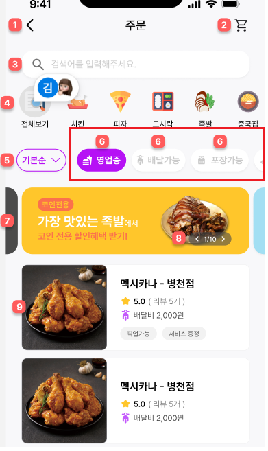

# 2-9 ~ 13 상점 카테고리 필터

원문 페이지 ID: c2e0221954bc820b8ce48181f96f89fc

> 원문 스냅샷. 명세 확정·앱 배포·수집 완료를 뜻하지 않습니다.

## 원문 속성

```json
{
  "platform": [
    "ANDROID",
    "IOS"
  ],
  "url": "source-page-id:c2e0221954bc820b8ce48181f96f89fc",
  "상태": "로깅 필요",
  "생성일": "2026-11-08T10:51:27.218Z",
  "이벤트 이름": "2-9 \\~ 13 상점 카테고리 필터",
  "태그": [
    "2. 상점 카테고리"
  ]
}
```

기존 기능 및 디자인 → 로깅 수정 및 추가(오른쪽 사진)

<columns>
<column ratio="50">

</column>
<column ratio="50">



</column>
</columns>

<columns>
<column ratio="50">
<span color="orange">event\_params.key</span>

<ul>
<li>
event\_label : shop\_can
</li>
<li>
value : 

- check\_delivery\_\{카테고리\}
- check\_open\_\{카테고리\}
</li>
<li>
event\_category : click 
</li>
</ul>
</column>
<column ratio="50">
- 영업중
- 배달가능
- 포장가능
- 배달팁무료
- 최소주문금액


<span color="orange">event\_params.key</span>

<ul>
<li>
event\_label : shop\_can
</li>
<li>
value : 

- check\_open\_\{카테고리\}
- check\_delivery\_\{카테고리\}
- check\_takeout\_\{카테고리\}
- check\_free\_delivery\_\{카테고리\}
- check\_min\_amount\_\{카테고리\}
</li>
<li>
event\_category : click 
</li>
</ul>
</column>
</columns>

---


메인화면이 아니면 주변상점 view인 경우, 영업중만 심어주시면 됩니다 !


<span color="orange">event\_params.key</span>

<ul>
<li>
event\_label : shop\_can
</li>
<li>
value : 

- check\_open\_\{카테고리\}
</li>
<li>
event\_category : click 
</li>
</ul>


