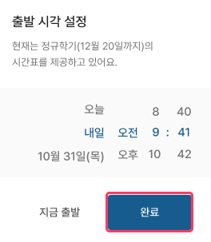
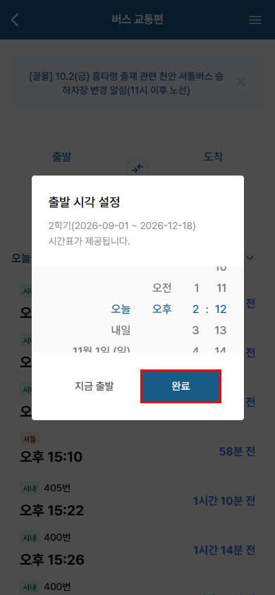

# 5-11. 완료_클릭

원문 페이지 ID: c360221954bc825293c301a04fc39430

> 원문 스냅샷. 명세 확정·앱 배포·수집 완료를 뜻하지 않습니다.

## 원문 속성

```json
{
  "platform": [
    "ANDROID",
    "IOS"
  ],
  "url": "source-page-id:c360221954bc825293c301a04fc39430",
  "구분": "출발 시각 설정",
  "상태": "완료",
  "생성일": "2026-11-08T10:51:42.314Z",
  "이벤트 이름": "5-11. 완료\\_클릭",
  "태그": [
    "5. 교통편 조회하기"
  ]
}
```

<details>
<summary>이전 로깅</summary>

- event\_label : “departure\_time\_setting\_done”
- value : “시간설정: Y”, “시간설정: N<b>”</b>
  - 출발 시각 설정 모달이 뜨고나서
    - 시간이 변경된 채 ‘완료 버튼’을 클릭했으면 “시간설정: Y”
    - 시간 변경 없이 ‘완료 버튼’을 클릭했으면 “시간설정: N”
- event\_category : “click”
- 참고사진


</details>

<details>
<summary>새 로깅 (26.10.17)</summary>

- 설명: 출발 시각 설정 창에서 완료를 클릭하는 경우
- screen\_view: <code>bus_search_result</code>
- event\_name: <code>DA1</code>
- event\_label: <code>bus__bus_search_result__search__departure_time_confirm__click</code>
- value: 시간 변경 / 시간 유지 (기존 시간설정: Y → 시간 변경, 시간설정: N → 시간 유지) (예: 시간 변경)
- event\_category: <code>click</code>

<details>
<summary>검토사항</summary>

- 통합 가이드: [로깅 통합 가이드](3c30221954bc8214b1c481c5bbb6fba5.md)
- 적용 플랫폼 속성은 ANDROID·IOS로 유지한다. 현재 모바일 참고사진은 2026-10-30 [운영 모바일 웹](https://koreatech.in/bus/route)의 파란색 실제 캡처이며, 출발 시간 설정 창의 완료 버튼 위치를 표시한다. 네이티브 앱 캡처·실제 전송·한 번 전송은 미확인이다. 웹 칸의 앱 전용 표기는 명세 적용 플랫폼에 관한 것으로 사진 촬영 출처와 구분한다.
- label DA2 기준 정렬 (2026-10-27): <code>bus__bus_search_result__departure_time__done__click</code> → <code>bus__bus_search_result__search__departure_time_confirm__click</code>
</details>

### 참고사진 (기능 표시)

<columns>
<column ratio="50">
<b>웹</b>

<details>
<summary>참고사진 · 웹</summary>

웹 — 앱 전용 화면 (웹 없음), 앱 캡처 필요
</details>
</column>
<column ratio="50">
<b>모바일</b>

<details>
<summary>참고사진 · 모바일</summary>





모바일 웹 · 운영 [https://koreatech.in/bus/route](https://koreatech.in/bus/route) 실제 파란색 화면을 2026-10-30에 캡처. 빨간 테두리: 출발 시간 설정 창의 완료 버튼. Android/iOS 네이티브 앱 캡처가 아니며 SDK 발화·한 번 전송은 미확인.

</details>
</column>
</columns>
</details>
