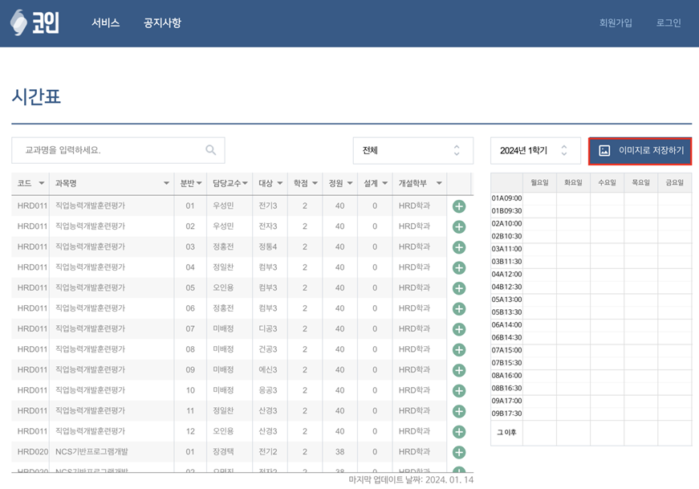
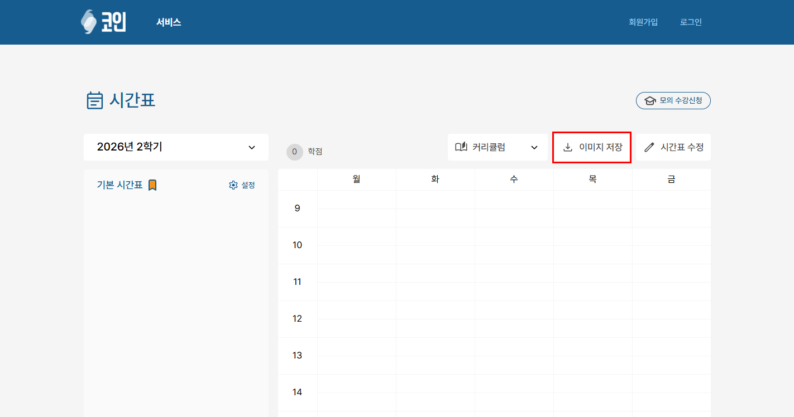
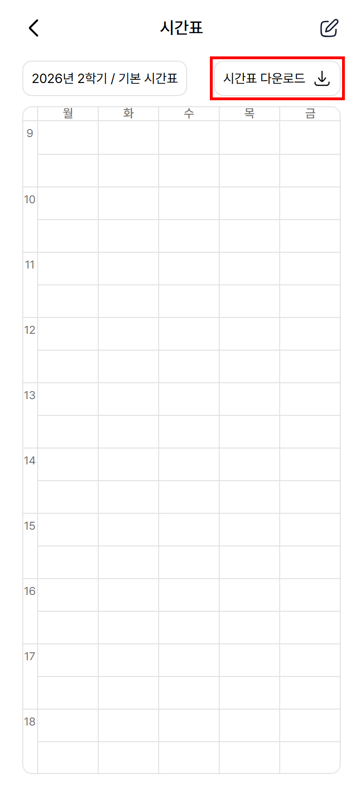

# 2-6. 시간표_이미지 저장 (클릭)

원문 페이지 ID: c3b0221954bc83a79f8f01721445c2be

> 원문 스냅샷. 명세 확정·앱 배포·수집 완료를 뜻하지 않습니다.

## 원문 속성

```json
{
  "platform": [
    "WEB",
    "ANDROID",
    "IOS"
  ],
  "url": "source-page-id:c3b0221954bc83a79f8f01721445c2be",
  "상태": "완료",
  "생성일": "2026-11-12T05:08:09.267Z",
  "이벤트 이름": "2-6. 시간표\\_이미지 저장 (클릭)",
  "태그": [
    "시간표"
  ]
}
```

<details>
<summary>과거 로깅</summary>

- event\_label : “timetable”
- value : “이미지저장”
- event\_category : “click”
- 참고 이미지


</details>

<details>
<summary>새 로깅</summary>

- 설명: 시간표 화면에서 이미지 저장(모바일은 시간표 다운로드) 버튼을 눌러 시간표를 이미지로 내려받는 경우
- screen\_view: <code>timetable</code>
- event\_name: <code>DA1</code>
- event\_label: <code>timetable__timetable__timetable_export__image_save__click</code>
- value: 이미지 저장
- event\_category: <code>click</code>

### 참고사진 (기능 표시)

<columns>
<column ratio="50">
<b>웹</b>

<b>참고사진 · 웹</b>

웹 — 이미지 저장 (출처: stage 실제 캡처, 빨간 네모 = 클릭 위치)


</column>
<column ratio="50">
<b>모바일</b>

<b>참고사진 · 모바일</b>

모바일 — 시간표 다운로드 (출처: stage 실제 캡처, 빨간 네모 = 클릭 위치)


</column>
</columns>
</details>
