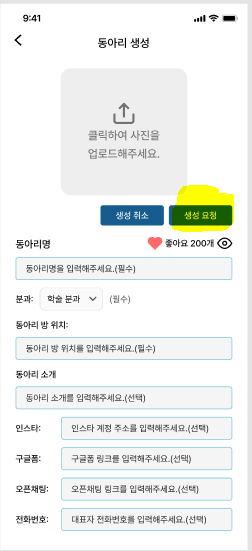
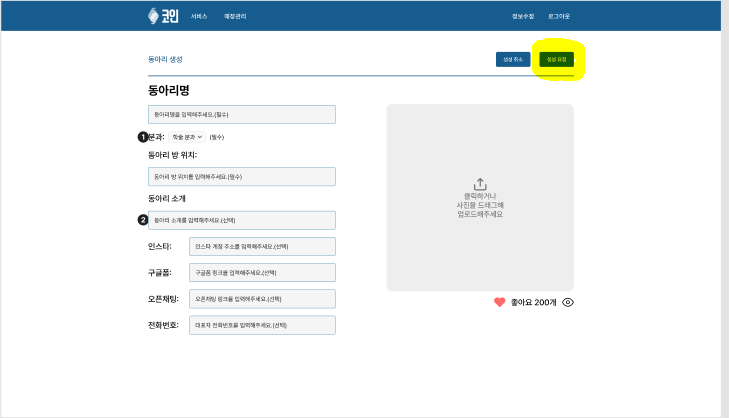

# 3-2. 동아리_동아리 생성요청

원문 페이지 ID: c510221954bc83219e86812231e78af3

> 필터 밖 원본 행 복구 스냅샷. 중복·빈 페이지도 원본 ID와 속성, 본문을 개별 보존합니다. 명세 승인이나 앱 적용 완료를 뜻하지 않습니다.

대조 기록: [숨겨진 원본 42개 복구](../hidden-recovery.md)

관련 기존 보관본: [레거시 3-2. 동아리_동아리 생성요청](ba40221954bc825ea3c5014c50b7ed9c.md), [레거시 3-2. 동아리_동아리 생성요청](1d20221954bc8227a4a18153e3b1db4b.md)

## 원문 속성

```json
{
  "platform": [
    "ANDROID",
    "IOS",
    "WEB"
  ],
  "url": "source-page-id:c510221954bc83219e86812231e78af3",
  "상태": "완료",
  "이름": "3-2. 동아리\\_동아리 생성요청"
}
```

<ul>
<li>
설명: 동아리 생성 화면 에서 생성 요청 클릭
</li>
<li>
event\_name : “CAMPUS”
</li>
<li>
event\_label : “club\_create\_request”
</li>
<li>
value : “생성요청”
</li>
<li>
event\_category : “click” 
</li>
<li>
참고사진
</li>
</ul>





- 웹 참고사진



