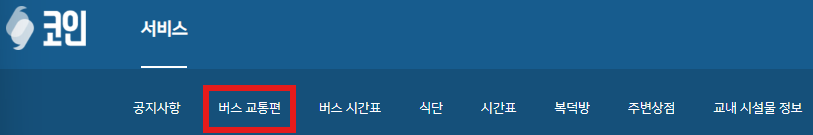

# 2-3. 헤더_버스 교통편_클릭

원문 페이지 ID: c630221954bc82e48ff8810a80d6f1f0

> 원문 스냅샷. 명세 확정·앱 배포·수집 완료를 뜻하지 않습니다.

## 원문 속성

```json
{
  "platform": [
    "WEB"
  ],
  "url": "source-page-id:c630221954bc82e48ff8810a80d6f1f0",
  "상태": "완료",
  "생성일": "2026-11-12T05:07:52.431Z",
  "이벤트 이름": "2-3. 헤더\\_버스 교통편\\_클릭",
  "태그": [
    "2. 헤더/푸터/햄버거_버스/교통"
  ]
}
```

<details>
<summary>과거 로깅</summary>

- event\_label : “header”
- value : “버스 교통편<b>”</b>
- event\_category : “click”
- 참고사진


</details>

<details>
<summary>새 로깅</summary>

- 설명: 웹 상단 헤더에서 버스 교통편을 클릭해 버스 교통편 조회 화면으로 들어가는 경우
- screen\_view: <code>header</code>
- event\_name: <code>DA1</code>
- event\_label: <code>bus__header__route__click</code>
- value: 버스 교통편
- event\_category: <code>click</code>

### 참고사진 (교통 → 버스 교통편 · WEB 리디자인)

<b>웹</b>

<b>참고사진 · 웹</b>

교통 → 버스 교통편. 출처: [Figma WEB 리디자인](https://www.figma.com/design/DPlcYuiFxhyT5ULbqec59i/KOIN-Web?node-id=11541-33352), 2026-11-04 원본 캡처에 코드로 빨간 네모만 추가. 빨간 네모는 기존 명세가 지칭하는 클릭 대상이다. 실제 클릭 가능 여부·SDK 적용·배포·수집은 미확인이다.


</details>
