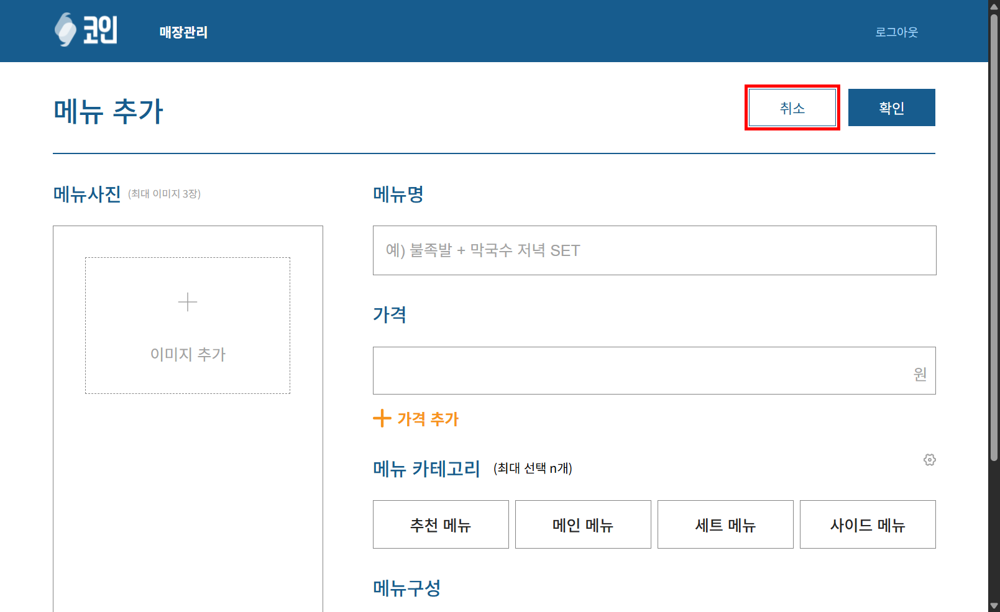

# 3-3 메뉴추가 - 취소

원문 페이지 ID: c840221954bc82f6ac96814ed5b53c23

> 원문 스냅샷. 명세 확정·앱 배포·수집 완료를 뜻하지 않습니다.

## 원문 속성

```json
{
  "platform": [
    "WEB"
  ],
  "url": "source-page-id:c840221954bc82f6ac96814ed5b53c23",
  "상태": "진행 중",
  "생성일": "2026-11-12T05:07:40.165Z",
  "이벤트 이름": "3-3 메뉴추가 - 취소",
  "태그": [
    "3. 메뉴 추가"
  ]
}
```

<details>
<summary>과거 로깅</summary>

<span color="orange">event\_params.key</span>

- event\_label : add\_menu\_cancel
- value : 메뉴 추가 취소
- event\_category : click


<p>
콘솔에서 오류 이슈 
</p>

/owner:1 Mixed Content: The page at '[https://owner.stage.koreatech.in/owner](https://owner.stage.koreatech.in/owner)' was loaded over HTTPS, but requested an insecure element '[http://static.koreatech.in/assets/img/ic-bcsd\_gray.png](http://static.koreatech.in/assets/img/ic-bcsd_gray.png)'. This request was automatically upgraded to HTTPS, For more information see [https://blog.chromium.org/2019/10/no-more-mixed-messages-about-https.html](https://blog.chromium.org/2019/10/no-more-mixed-messages-about-https.html)


</details>

<details>
<summary>새 로깅</summary>

- 설명: 사장님 메뉴 추가 화면에서 취소 버튼을 클릭해 등록하지 않고 가게 정보 화면(/owner)으로 돌아가는 경우
- screen\_view: <code>owner_menu_add</code>
- event\_name: <code>DA1</code>
- event\_label: <code>owner__owner_menu_add__shop_menu_manage__add_cancel__click</code>
- value: 메뉴 추가 취소
- event\_category: <code>click</code>

### 참고사진 (취소 버튼)

<columns>
<column ratio="50">
<b>웹</b>

<b>참고사진 · 웹</b>

웹 — 메뉴 추가 취소 (출처: stage 실제 캡처, 빨간 네모 = 클릭 위치)


</column>
<column ratio="50">
<b>모바일</b>

<b>참고사진 · 모바일</b>

모바일 — 해당 없음 (웹 전용)
</column>
</columns>
</details>
