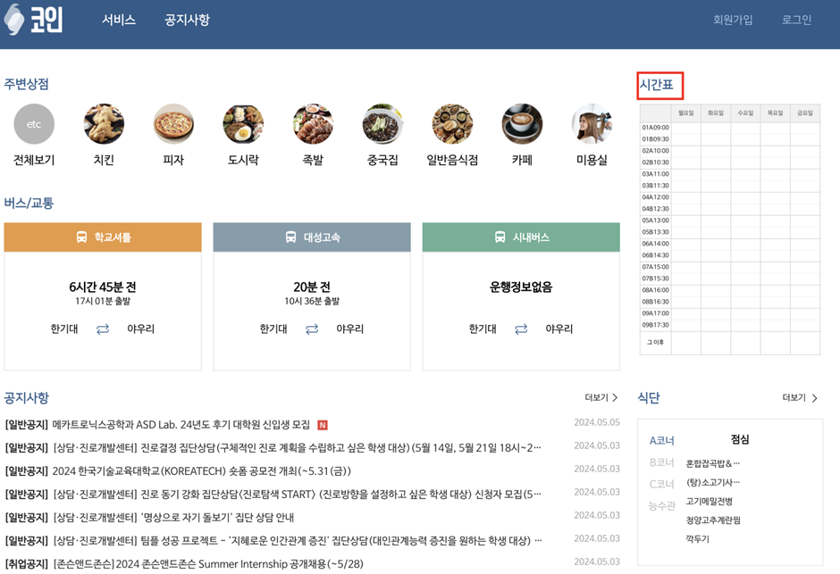
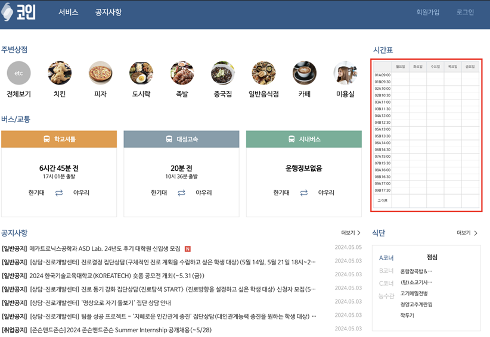

# 2-1~2. (웹) 메인_시간표

원문 페이지 ID: c860221954bc83548fe4818078674bba

> 원문 스냅샷. 명세 확정·앱 배포·수집 완료를 뜻하지 않습니다.

## 원문 속성

```json
{
  "platform": [
    "WEB"
  ],
  "url": "source-page-id:c860221954bc83548fe4818078674bba",
  "상태": "완료",
  "생성일": "2026-11-08T10:52:11.789Z",
  "이벤트 이름": "2-1\\~2. (웹) 메인\\_시간표",
  "태그": [
    "시간표"
  ]
}
```

<details>
<summary>이전 로깅</summary>

- event\_label : “main\_timetable”
- value : “text<b>”, “table”</b>
- event\_category : “click”
- 참고 이미지




</details>

<details>
<summary>새 로깅 (26.10.17)</summary>

- 레거시: 지금 웹 메인 화면에는 시간표 위젯(시간표 글자·표)이 없어(stage 2026-10-14 확인) 새 로깅을 만들지 않는다.
- 대체 로깅: 2-3. (웹) 헤더\_시간표 (timetable\_\_header\_\_timetable\_entry\_\_header\_entry\_\_click), 2-4. (웹) 푸터\_시간표 (timetable\_\_footer\_\_timetable\_entry\_\_footer\_entry\_\_click)

<details>
<summary>검토사항</summary>

- 통합 가이드·후속: [로깅 통합 가이드](3c30221954bc8214b1c481c5bbb6fba5.md)
- 이전 로깅 사진 2장은 웹/모바일 구분이 기록되지 않은 레거시 캡처라 참고사진 칸에 옮기지 않았다.
- label 점검 정정 (2026-10-28): <code>timetable__header__entry__click</code> / <code>timetable__footer__entry__click</code> → <code>timetable__header__timetable_entry__header_entry__click</code> / <code>timetable__footer__timetable_entry__footer_entry__click</code> (대체 로깅 안내가 대상 페이지 2-3, 2-4의 현재 라벨과 다름)
</details>

### 참고사진 (기능 표시)

<columns>
<column ratio="50">
<b>웹</b>

<details>
<summary>참고사진 · 웹</summary>

해당 없음 (레거시)
</details>
</column>
<column ratio="50">
<b>모바일</b>

<details>
<summary>참고사진 · 모바일</summary>

해당 없음 (레거시)
</details>
</column>
</columns>
</details>
