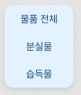
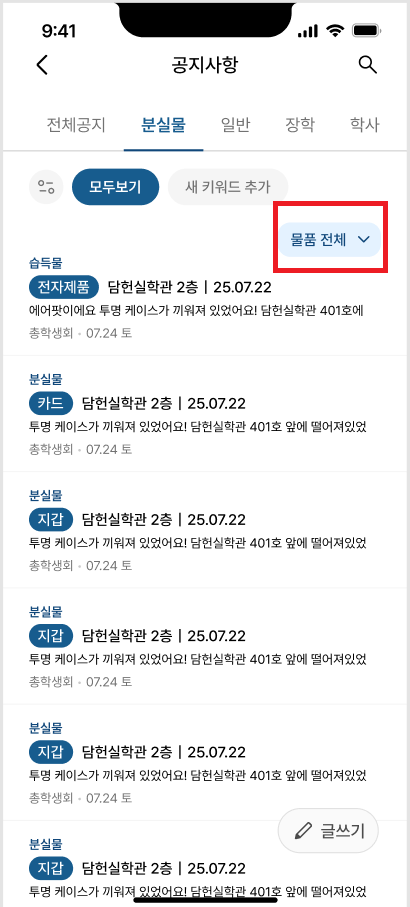

# 11-18.분실물_게시물종류_클릭

원문 페이지 ID: c900221954bc827daf8a81b63360cb8c

> 누락 원본 복구 스냅샷. 원본의 과거값·검토 기록을 보존하며 생성 계약으로 자동 승인하지 않습니다.

대조 기록: [87개 원본 복구 및 8개 차이 정리](../recovery-review.md)

관련 기존 보관본: [11-18.분실물_게시물종류_클릭 (11-23 통합)](e7c0221954bc82e194200103d9b04e18.md), [11-18.분실물_게시물종류_클릭 (11-23 통합)](bd00221954bc82628f2e01006b5fd031.md)

## 원문 속성

```json
{
  "platform": [
    "ANDROID",
    "IOS"
  ],
  "url": "source-page-id:c900221954bc827daf8a81b63360cb8c",
  "상태": "완료",
  "이름": "11-18.분실물\\_게시물종류\\_클릭"
}
```

<ul>
<li>
설명 : 분실물 게시글 목록에서 첨부파일에 표시된 버튼을 클릭하여 3개의 버튼중 1개의 버튼을 클릭
</li>
<li>
event\_label : “item\_post\_type”
</li>
<li>
value : “물품 전체<b>”, “분실물”, “습득물”</b>
</li>
<li>
event\_category : “click” 
</li>
<li>
참고사진
</li>
<li>
WEB, MOBILE\_WEB\_VIEW는 디자인 에서 해당 기능이 없었습니다.
</li>
</ul>






