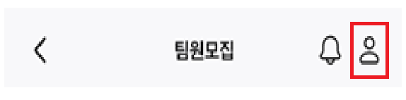
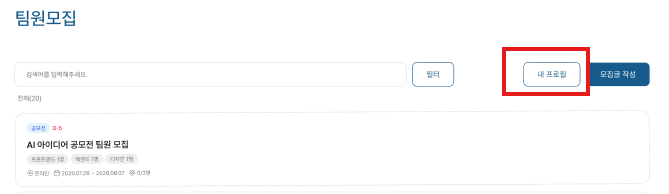
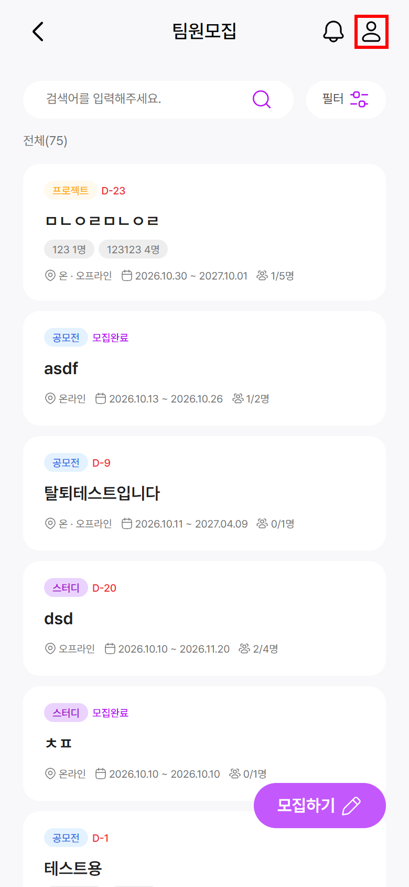

# 7. 프로필 클릭

원문 페이지 ID: c930221954bc82359bbc018abd8b7030

> 원문 스냅샷. 명세 확정·앱 배포·수집 완료를 뜻하지 않습니다.

## 원문 속성

```json
{
  "platform": [
    "WEB",
    "ANDROID",
    "IOS"
  ],
  "url": "source-page-id:c930221954bc82359bbc018abd8b7030",
  "구분": "프로필",
  "상태": "로깅 필요",
  "생성일": "2026-11-12T05:08:12.999Z",
  "이벤트 이름": "7\\. 프로필 클릭"
}
```

<details>
<summary>과거 로깅</summary>

- event\_label : team\_recruitment\_profile
- value : 프로필
- event\_category : “click”





</details>

<details>
<summary>새 로깅</summary>

- 설명: 팀원 모집 목록 화면에서 프로필 아이콘(mobile) / 내 프로필 버튼(web)을 클릭해 팀원 모집 프로필 화면으로 들어가는 경우 (비로그인이면 로그인 화면으로 이동)
- screen\_view: <code>team_list</code>
- event\_name: <code>DA1</code>
- event\_label: <code>team_recruit__team_list__team_profile__entry__click</code>
- value: 프로필
- event\_category: <code>click</code>

### 참고사진 (프로필 클릭)

<columns>
<column ratio="50">
<b>웹</b>

<b>참고사진 · 웹</b>

웹 — 사진 없음 (추가 필요)
</column>
<column ratio="50">
<b>모바일</b>

<b>참고사진 · 모바일</b>

모바일 — 프로필 클릭 (출처: stage 실제 캡처, 빨간 네모 = 클릭 위치)


</column>
</columns>
</details>
