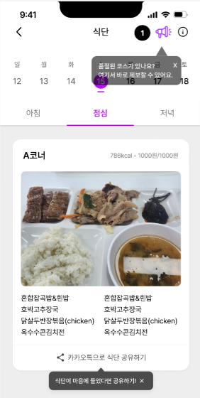
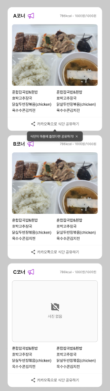

# 1. 품절 제보 버튼_식단 진입

원문 페이지 ID: c9b0221954bc82a9a116015696f51908

> 원문 스냅샷. 명세 확정·앱 배포·수집 완료를 뜻하지 않습니다.

## 원문 속성

```json
{
  "platform": [
    "ANDROID",
    "IOS",
    "WEB"
  ],
  "url": "source-page-id:c9b0221954bc82a9a116015696f51908",
  "상태": "로깅 필요",
  "생성일": "2026-11-08T10:51:35.586Z",
  "이름": "1\\. 품절 제보 버튼\\_식단 진입",
  "태그": [
    "0. A/B TEST"
  ]
}
```

<details>
<summary>이전 로깅</summary>

없음 (새로 추가한 로깅)
</details>

<details>
<summary>새 로깅 (26.10.17)</summary>

- 설명: 사용자가 식단 화면에 진입(홈화면에서 식단으로 진입 or 카테고리에서 식단으로 진입) 하는 순간 생성되는 이벤트입니다.
- screen\_view: <code>cafeteria</code>
- event\_name: <code>DA1</code>
- event\_label: <code>cafeteria__dining__abtest__exposure</code>
- value: A안 / B안
- event\_category: <code>exposure</code>

<details>
<summary>검토사항</summary>

- 이미 구현 완료된 명세 — 수정 금지 (2026-10-27 사용자 확인). value 표기는 원문대로 복원.
- 통합 가이드·후속: [로깅 통합 가이드](3c30221954bc8214b1c481c5bbb6fba5.md)
- 로깅 네이밍룰 대규모 개편으로 인해 event\_name이 기존 CAMPUS, BUSINESS, USER 대신 DA1, DA2 등의 형식으로 수집되도록 변경하였습니다. 참고하시기를 바랍니다!!
- 참고사진(A안/B안 시안)은 사진 플랫폼 확인 완료 (이미지 비율 기준: 모바일, 282x560 / 217x770, 앱 시안이라 모바일 칸으로 옮김)
</details>

### 참고사진 (품절 제보 버튼 A/B 식단 진입)

<columns>
<column ratio="50">
<b>웹</b>

<details>
<summary>참고사진 · 웹</summary>

웹 — 사진 없음 (추가 필요)
</details>
</column>
<column ratio="50">
<b>모바일</b>

<details>
<summary>참고사진 · 모바일</summary>

모바일 — A안 시안



모바일 — B안 시안


</details>
</column>
</columns>
</details>


