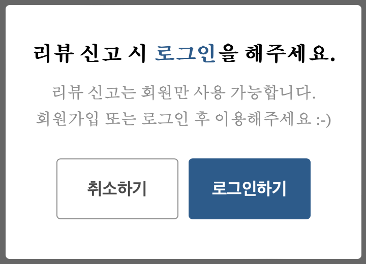
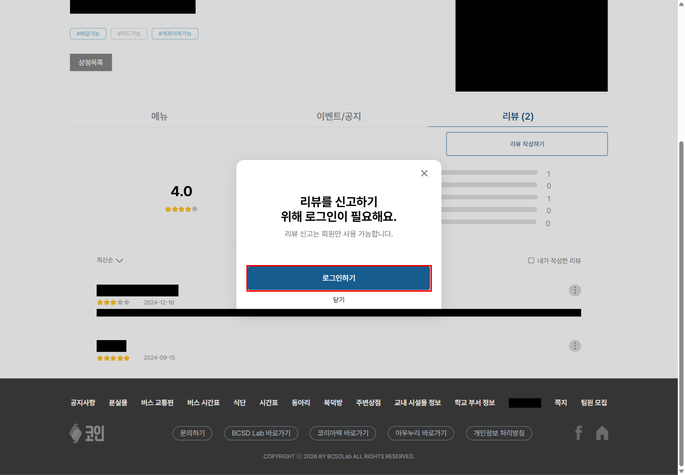
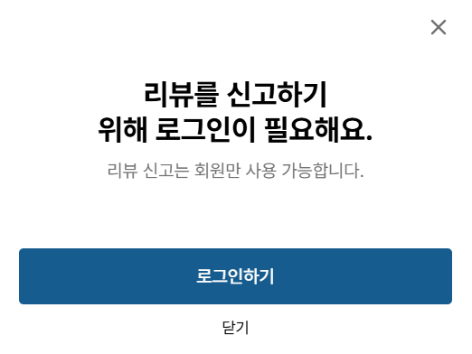
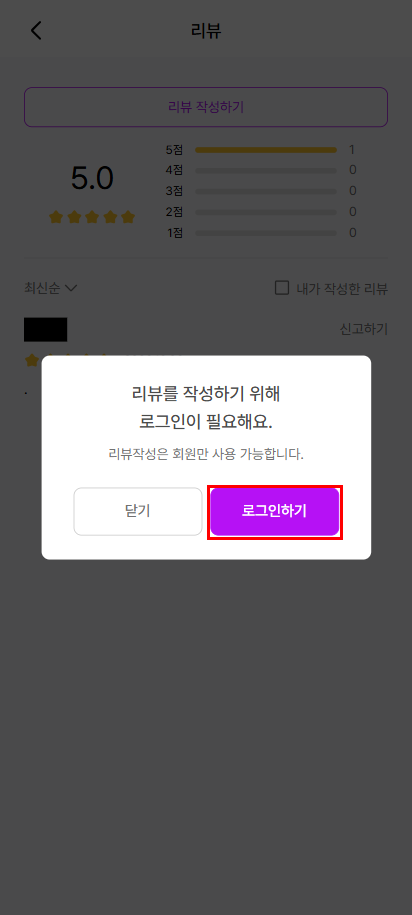
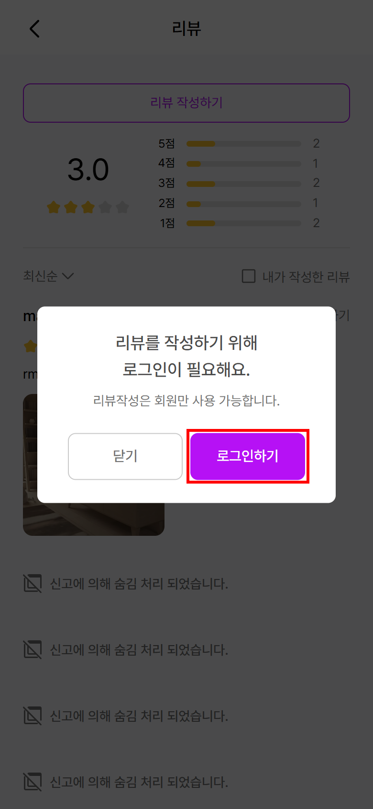
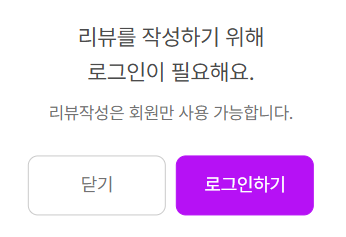

# 3-24 상점상세 리뷰신고 _로그인  (비로그인) 

원문 페이지 ID: c9f0221954bc83eea8a401c97041f7f2

> 원문 스냅샷. 명세 확정·앱 배포·수집 완료를 뜻하지 않습니다.

## 원문 속성

```json
{
  "platform": [
    "WEB",
    "ANDROID",
    "IOS"
  ],
  "url": "source-page-id:c9f0221954bc83eea8a401c97041f7f2",
  "상태": "완료",
  "생성일": "2026-11-08T10:51:49.243Z",
  "이벤트 이름": "<p>\n3-24 상점상세 리뷰신고 \\_로그인  (비로그인) \n</p>",
  "태그": [
    "3. 상점 상세 페이지"
  ]
}
```

<details>
<summary>이전 로깅</summary>

<span color="orange">event\_params.key</span>

<ul>
<li>
event\_label : shop\_detail\_view\_review\_report\_login
</li>
<li>
value : \{상점이름\} 
</li>
<li>
event\_category : click
</li>
</ul>



---
</details>

<details>
<summary>새 로깅 (26.10.17)</summary>

- 설명: 로그인하지 않은 상태에서 리뷰 신고를 누르면 뜨는 로그인 안내 팝업에서 로그인 버튼을 클릭하는 경우
- screen\_view: <code>shop_detail</code>
- event\_name: <code>DA1</code>
- event\_label: <code>account__shop_detail__login_popup__login_entry__click</code>
- value: \{상점이름\} (예: 복지관 매점)
- event\_category: <code>click</code>

<details>
<summary>검토사항</summary>

- 모바일 웹 실화면 확인 (2026-10-30): 보라색 모바일 웹에서 실제 신고하기를 눌러도 리뷰를 작성하기 위해 로그인이 필요해요 / 리뷰작성은 회원만 사용 가능합니다 문구가 나타나는 것을 직접 확인했다. 기존 사진을 오첨부로 단정하지 않는다. Android/iOS 네이티브 앱 동작과 SDK 전송은 이 확인에 포함하지 않는다.
- WEB 실화면 재검수 (2026-10-30): 비로그인 상태에서 실제 리뷰 신고 메뉴를 열어 WEB 안내창의 리뷰 신고 문구와 로그인하기 위치를 확인했다. 기존 모바일 사진의 리뷰 작성 문구가 앱 공용 UI인지 여부는 WEB 확인만으로 단정하지 않으며 모바일 검증은 보류한다. 기존 라벨·value·발생 시점은 유지한다.
- 명세 중복 정리 (2026-10-27): <code>account__shop_detail__login_popup__login_entry__click</code>의 기준 명세는 [3-22 상점상세 리뷰작성 들어가기_로그인누름 (비로그인)  ](e080221954bc8335a68681d895e57fb3.md). 리뷰 작성·신고 경로에서 같은 로그인 팝업 응답을 나타낸다. 같은 사용자 동작은 한 번만 전송하며, 문서가 여러 개라는 이유로 추가 이벤트를 보내지 않는다. 기존 value·플랫폼·발생 시점은 유지한다. / 통합 가이드: [로깅 통합 가이드](3c30221954bc8214b1c481c5bbb6fba5.md)
- label DA2 기준 정렬 (2026-10-27): <code>shop__shop_detail__review_report__login__click</code> → <code>account__shop_detail__login_popup__login_entry__click</code>
</details>

### 참고사진 (비로그인 리뷰 신고 → 로그인)

<columns>
<column ratio="50">
<b>웹</b>

<details>
<summary>참고사진 · 웹</summary>





WEB · [koreatech.in](http://koreatech.in) 운영 사이트 비로그인 리뷰 신고 안내 → 로그인하기. 실제 문구: 리뷰를 신고하기 위해 로그인이 필요해요. 빨간 테두리=로그인하기. 개인정보는 검은색 마스킹. 로그인이나 신고 제출은 수행하지 않았다.

</details>

<details>
<summary>교체 전 참고사진 · 웹 (이력)</summary>

웹 — 로그인 버튼 클릭 (출처: 기존 캡처)


</details>
</column>
<column ratio="50">
<b>모바일</b>

<details>
<summary>참고사진 · 모바일</summary>





모바일 웹 · 실제 신고하기를 눌러 열린 현행 보라색 로그인 안내. 실제 표시 문구는 리뷰 작성이며 UI를 수정하지 않았다. 빨간 테두리=로그인하기. 닉네임 검은색 마스킹.

</details>

<details>
<summary>기존 보라색 모바일 참고사진</summary>

모바일 — 로그인 버튼 클릭 (출처: stage 실제 캡처, 빨간 네모 = 클릭 위치)




</details>
</column>
</columns>
</details>
