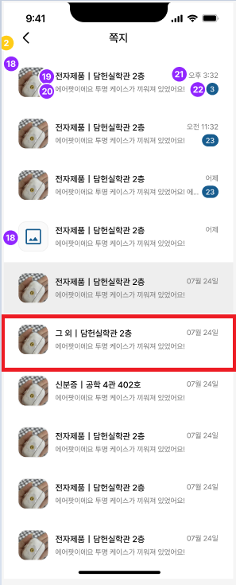
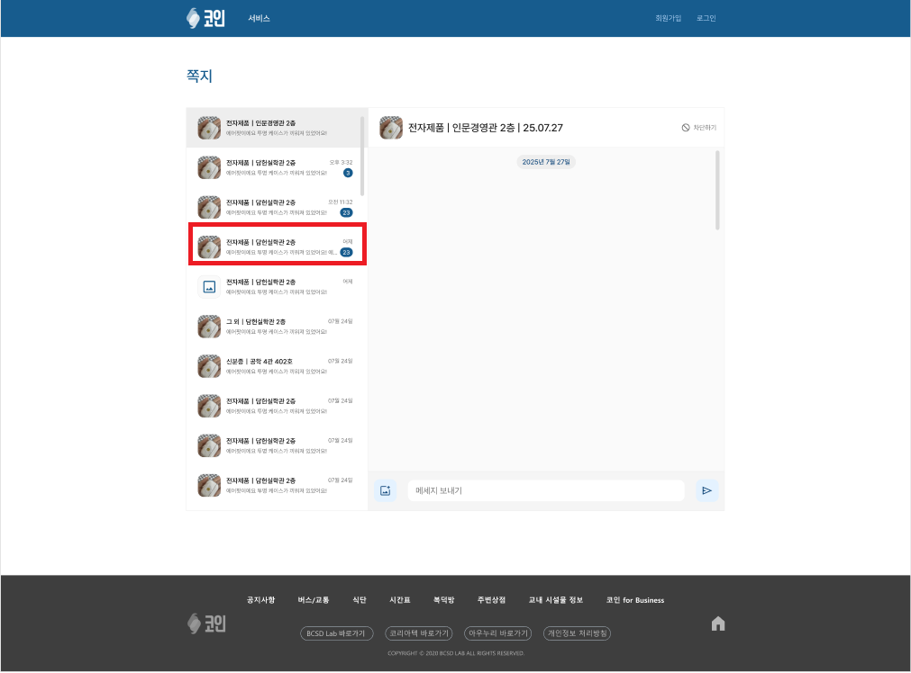
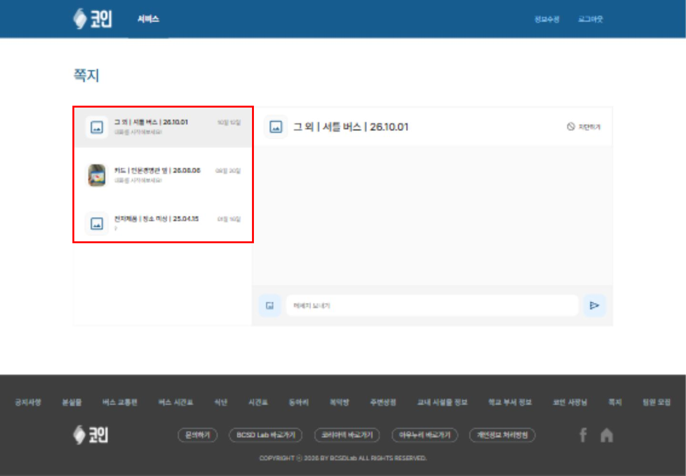
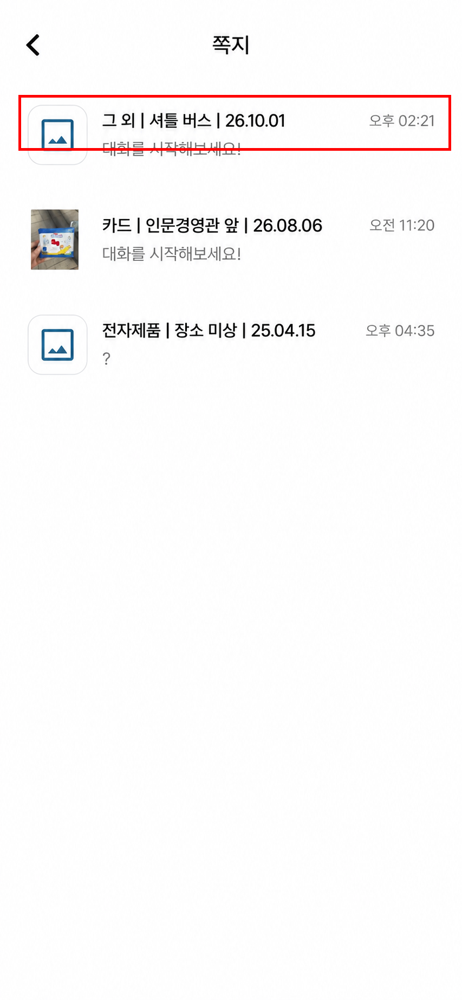

# 11-16.쪽지리스트_대화창_클릭

원문 페이지 ID: cb20221954bc8335977e012e2347e4ee

> 원문 스냅샷. 명세 확정·앱 배포·수집 완료를 뜻하지 않습니다.

## 원문 속성

```json
{
  "platform": [
    "ANDROID",
    "IOS",
    "WEB"
  ],
  "url": "source-page-id:cb20221954bc8335977e012e2347e4ee",
  "상태": "완료",
  "이름": "11-16.쪽지리스트\\_대화창\\_클릭",
  "태그": [
    "11.분실물"
  ]
}
```

<details>
<summary>이전 로깅</summary>

- 설명:  쪽지 리스트에서 특정 대화창을 클릭
- event\_label : “message\_list\_select”
- value : “쪽지”
- event\_category : “click”
- 참고사진

Mobile, Mobile\_Web\_VIEW



WEB




</details>

<details>
<summary>새 로깅 (2026-10-14) — 초안</summary>

- 설명: 쪽지 목록의 대화 항목을 클릭해 해당 대화를 선택할 때 기록한다. WEB의 통합 화면 안 목록 영역도 같은 논리 화면으로 취급한다.
- screen\_view: <code>chat_list</code>
- event\_label: <code>chat__chat_list__chat_conversation__entry__click</code>
- event\_name: <code>DA2</code>
- value: 쪽지
- event\_category: <code>click</code>

<details>
<summary>검토사항</summary>

- 웹·모바일 공통 계약 (2026-11-05 사용자 승인): 같은 기능의 screen\_view와 event\_label은 플랫폼과 관계없이 아래 공통값을 사용한다. 기존 플랫폼별 화면명 유지 지시는 이 결정으로 대체한다. 플랫폼은 기존 DB 속성으로 구분하며 value·event\_name·event\_category·기존 전송 시점·이전 로깅·사진은 유지한다. 실제 SDK 적용·배포·단일 전송은 미확인이다. 공통값: <code>chat_list</code> / <code>chat__chat_list__chat_conversation__entry__click</code>.
- 통합 가이드·후속: [로깅 통합 가이드](3c30221954bc8214b1c481c5bbb6fba5.md)
- label 통일 (2026-10-27): chat\_\_chat\_list\_\_chat\_conversation\_\_entry → …\_\_entry\_\_click (모바일), chat\_\_chat\_\_chat\_conversation\_\_entry → …\_\_entry\_\_click (웹)
- 이전 물리 화면 설명 (2026-11-05 논리 화면 공통화): 웹은 목록·대화 통합 화면 chat을 유지한다. 모바일 클릭 시점은 chat\_list이며 도착 화면 chat\_detail을 쓰지 않음. 모바일은 ANDROID·IOS 공통 디자인 기준. 현재 이 클릭은 WEB·모바일 모두 chat\_list로 기록한다.
</details>

### 참고사진 (기능 표시)

<columns>
<column ratio="50">
<b>웹(데스크톱)</b>

<details>
<summary>참고사진 · 웹</summary>

실제 데스크톱 WEB 캡처(2026-10-16). 빨간 박스는 대화 항목 클릭 영역이다. 목록과 대화는 한 화면에 있고, 대화 선택은 query만 변경하므로 screen\_view는 chat을 유지한다.


</details>
</column>
<column ratio="50">
<b>모바일 (ANDROID, IOS) / 캡처 출처는 아래 참조</b>

<details>
<summary>참고사진 · 모바일</summary>

화면 정의의 Android 실제 캡처(2026-10-13), 선명도 개선본. 이번 작업은 기존 캡처를 사용.


</details>
</column>
</columns>
</details>
