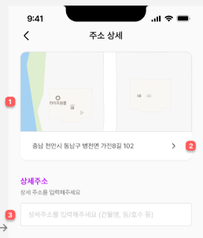

# 7-11 결제 → 교외 주문 페이지 주소 재설정

원문 페이지 ID: cb20221954bc83fa9856010323c70b86

> 원문 스냅샷. 명세 확정·앱 배포·수집 완료를 뜻하지 않습니다.

## 원문 속성

```json
{
  "platform": [
    "WEB"
  ],
  "url": "source-page-id:cb20221954bc83fa9856010323c70b86",
  "상태": "로깅 필요",
  "생성일": "2026-11-12T05:07:46.899Z",
  "이벤트 이름": "7-11 결제 → 교외 주문 페이지 주소 재설정",
  "태그": [
    "7. 결제 페이지"
  ]
}
```




2번. 주소 재설정 버튼 클릭 시 발생 로깅입니다


event\_params.key

- event\_label : payment\_off\_campus\_address\_reset
- value :
- event\_category :
  - click
