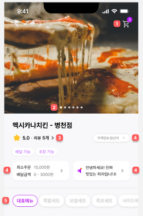

# 3-3 상점 상세 스크롤 상점정보

원문 페이지 ID: cc30221954bc8228845c01db59165103

> 원문 스냅샷. 명세 확정·앱 배포·수집 완료를 뜻하지 않습니다.

## 원문 속성

```json
{
  "platform": [
    "ANDROID",
    "IOS",
    "WEB"
  ],
  "url": "source-page-id:cc30221954bc8228845c01db59165103",
  "상태": "완료",
  "생성일": "2026-11-08T10:51:53.763Z",
  "이벤트 이름": "3-3 상점 상세 스크롤 상점정보",
  "태그": [
    "3. 상점 상세 페이지"
  ]
}
```




숫자 4로 표시된 3가지 버튼 모두 동일한 로깅으로 심어주시면 됩니다!


<span color="orange">event\_params.key</span>

<ul>
<li>
event\_label : shop\_detail\_view\_info
</li>
<li>
value : \{상점이름\} 
</li>
<li>
event\_category : 

<ul>
<li>
click 
</li>
</ul>


</li>
</ul>

---


