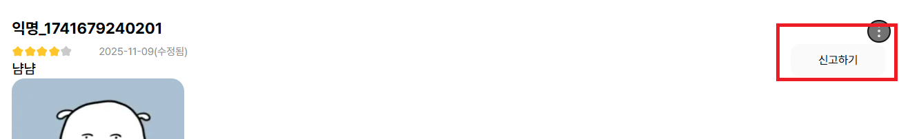
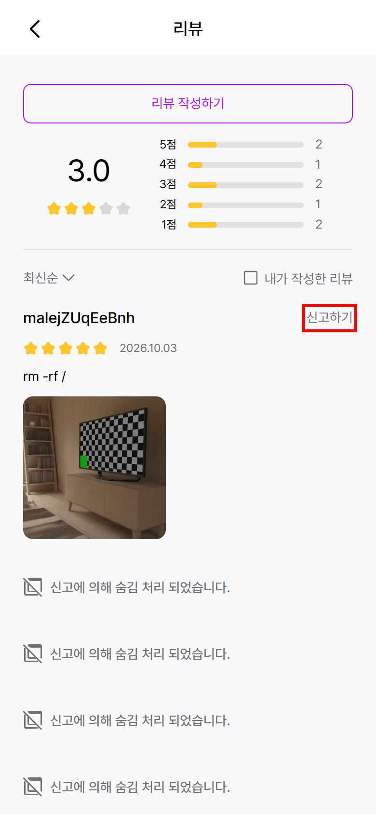

# 3-14 상점상세 리뷰 신고 (클릭) 

원문 페이지 ID: cc30221954bc834095f981fa04ca86f3

> 원문 스냅샷. 명세 확정·앱 배포·수집 완료를 뜻하지 않습니다.

## 원문 속성

```json
{
  "platform": [
    "WEB",
    "ANDROID",
    "IOS"
  ],
  "url": "source-page-id:cc30221954bc834095f981fa04ca86f3",
  "상태": "완료",
  "생성일": "2026-11-12T05:07:35.330Z",
  "이벤트 이름": "<p>\n3-14 상점상세 리뷰 신고 (클릭) \n</p>",
  "태그": [
    "3. 상점 상세 페이지"
  ]
}
```

<details>
<summary>과거 로깅</summary>

<span color="orange">event\_params.key</span>

<ul>
<li>
event\_label : shop\_detail\_view\_review\_report
</li>
<li>
value : \{상점이름\} 
</li>
<li>
event\_category : click
</li>
</ul>


---
</details>

<details>
<summary>새 로깅</summary>

- 설명: 상점 상세 화면(리뷰 탭)에서 리뷰 신고 버튼을 클릭하는 경우
- screen\_view: <code>shop_detail</code>
- event\_name: <code>DA1</code>
- event\_label: <code>shop__shop_detail__review_report__entry__click</code>
- value: \{상점이름\} (예: 복지관 매점)
- event\_category: <code>click</code>

### 참고사진 (리뷰 신고 클릭)

<columns>
<column ratio="50">
<b>웹</b>

<b>참고사진 · 웹</b>

웹 — 리뷰 신고 클릭 (출처: 기존 캡처)


</column>
<column ratio="50">
<b>모바일</b>

<b>참고사진 · 모바일</b>

모바일 — 신고하기 버튼 클릭 (출처: stage 실제 캡처, 빨간 네모 = 클릭 위치)


</column>
</columns>
</details>
