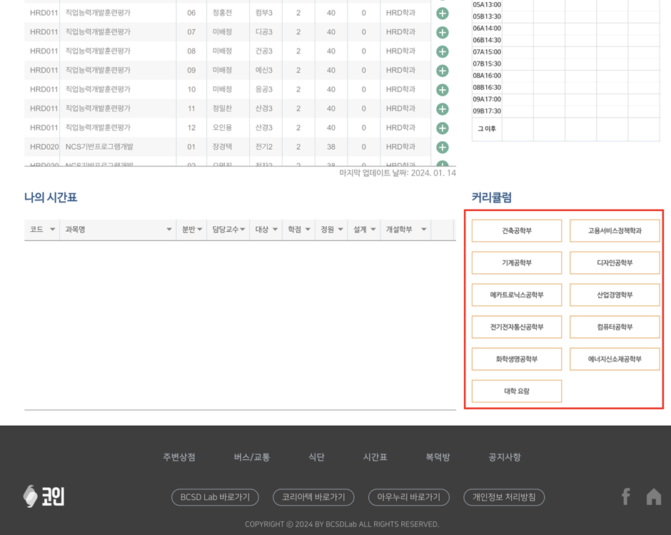
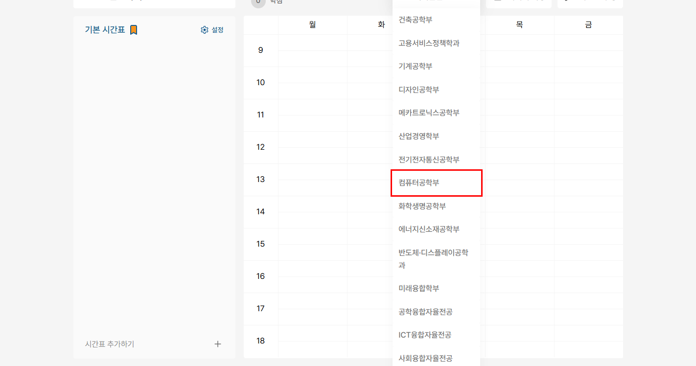

# 2-8. 시간표_커리큘럼 (클릭)

원문 페이지 ID: cd00221954bc82e9b4d9017bb2863f62

> 원문 스냅샷. 명세 확정·앱 배포·수집 완료를 뜻하지 않습니다.

## 원문 속성

```json
{
  "platform": [
    "WEB"
  ],
  "url": "source-page-id:cd00221954bc82e9b4d9017bb2863f62",
  "상태": "완료",
  "생성일": "2026-11-08T10:52:11.813Z",
  "이벤트 이름": "2-8. 시간표\\_커리큘럼 (클릭)",
  "태그": [
    "시간표"
  ]
}
```

<details>
<summary>이전 로깅</summary>

- event\_label : “timetable”
- value : “click\_curriculum\_\{학과\}”
- event\_category : “click”
- 참고 이미지


</details>

<details>
<summary>새 로깅 (26.10.17)</summary>

- 설명: 웹 시간표 화면의 커리큘럼 드롭다운을 열고 학과(학부)를 골라 해당 학과 커리큘럼을 보는 경우
- screen\_view: <code>timetable</code>
- event\_name: <code>DA1</code>
- event\_label: <code>timetable__timetable__search__curriculum__select</code>
- value: \{학과\} (예: 디자인ㆍ건축공학부) · 학과명은 드롭다운 표기 그대로(가운뎅점 ㆍ 포함)
- event\_category: <code>select</code>

<details>
<summary>검토사항</summary>

- 통합 가이드·후속: [로깅 통합 가이드](3c30221954bc8214b1c481c5bbb6fba5.md)
- 모바일: 없음
- label DA2 기준 정렬 (2026-10-27): <code>timetable__timetable__curriculum__select</code> → <code>timetable__timetable__search__curriculum__select</code>
</details>

### 참고사진 (기능 표시)

<columns>
<column ratio="50">
<b>웹</b>

<details>
<summary>참고사진 · 웹</summary>

웹 — 커리큘럼 학과 선택 (출처: stage 실제 캡처, 빨간 네모 = 클릭 위치)


</details>
</column>
<column ratio="50">
<b>모바일</b>

<details>
<summary>참고사진 · 모바일</summary>

해당 없음 (웹 전용)
</details>
</column>
</columns>
</details>
