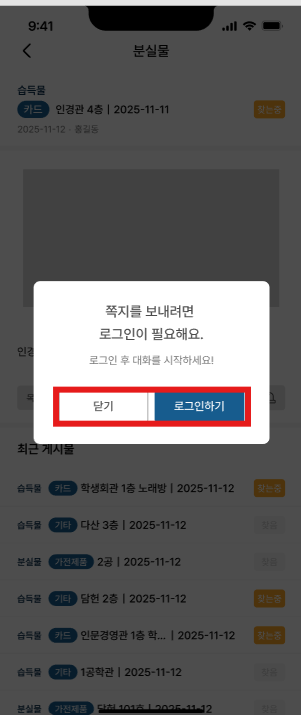
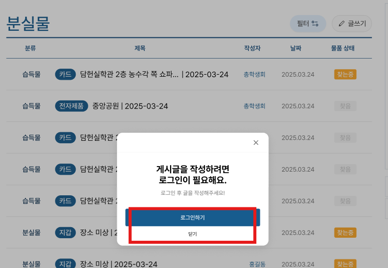
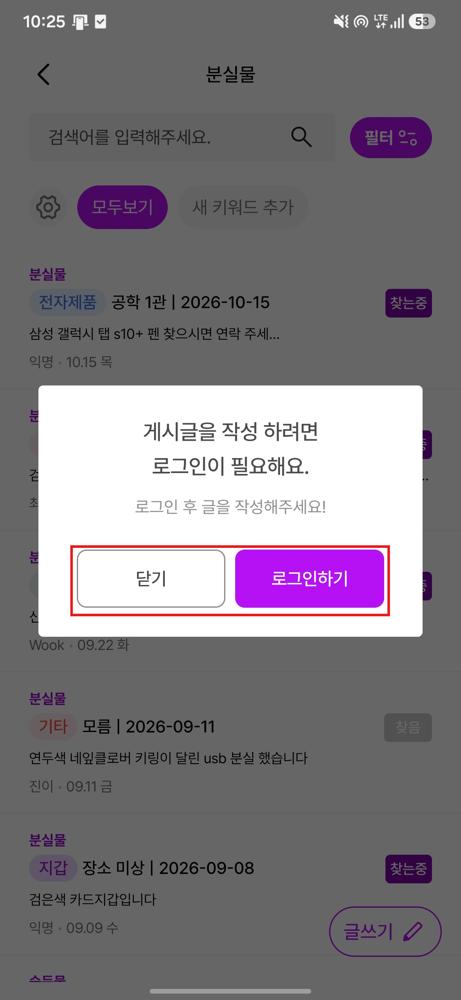

# 11-26. 분실물_글쓰기_로그인요청_클릭

원문 페이지 ID: cdd0221954bc833b80a881ce3dc985db

> 원문 스냅샷. 명세 확정·앱 배포·수집 완료를 뜻하지 않습니다.

## 원문 속성

```json
{
  "platform": [
    "ANDROID",
    "IOS",
    "WEB"
  ],
  "url": "source-page-id:cdd0221954bc833b80a881ce3dc985db",
  "상태": "완료",
  "이름": "11-26. 분실물\\_글쓰기\\_로그인요청\\_클릭",
  "태그": [
    "11.분실물"
  ]
}
```

<details>
<summary>이전 로깅</summary>

- 설명: 로그인 요청 모달에서 ‘닫기’ 혹은 ‘로그인하기’ 버튼 중 클릭하는 버튼에 따라 ‘value’를 달리 해주시면 될 것 같습니다
- event\_label : lost\_item\_write\_login\_request
- value : ‘닫기’ or ‘로그인하기’
- event\_category : click
- 참고사진




</details>

<details>
<summary>새 로깅 (26.10.12) — 초안</summary>

- 설명: 글쓰기에서 표시된 로그인 요청 팝업의 닫기 또는 로그인하기 버튼을 클릭.
- screen\_view: <code>lost_item_list</code>
- event\_name: <code>DA2</code>
- event\_label:
  - 로그인하기 응답: <code>account__lost_item_list__login_popup__login_entry__click</code>
  - 닫기 응답: <code>account__lost_item_list__login_popup__close__click</code>
- value: 닫기 / 로그인하기
- event\_category: <code>click</code>

<details>
<summary>검토사항</summary>

- 통합 가이드·후속: [로깅 통합 가이드](3c30221954bc8214b1c481c5bbb6fba5.md)
- label 통일 (2026-10-27): <code>account__lost_item_list__login_popup__login_entry</code> → <code>...__login_entry__click</code>, <code>account__lost_item_list__login_popup__close</code> → <code>...__close__click</code>
- 로그인 안내 팝업은 login\_popup 기능으로 통일한다. 실제 누른 버튼에 해당하는 label 하나만 전송한다. 기존 value와 category, 클릭 시점은 유지하며 추가 전송을 만들지 않는다.
</details>

### 참고사진 (기능 표시)

<columns>
<column ratio="50">
<b>웹</b>

<details>
<summary>참고사진 · 웹</summary>

웹 — 글쓰기 로그인 요청의 로그인하기·닫기 (기존 로깅 캡처)


</details>
</column>
<column ratio="50">
<b>모바일</b>

<details>
<summary>참고사진 · 모바일</summary>

모바일 — 글쓰기 로그인 요청. 2026-10-16 사용자가 현재 버전 캡처로 수정 완료한 사진을 유지한다.


</details>
</column>
</columns>


</details>
