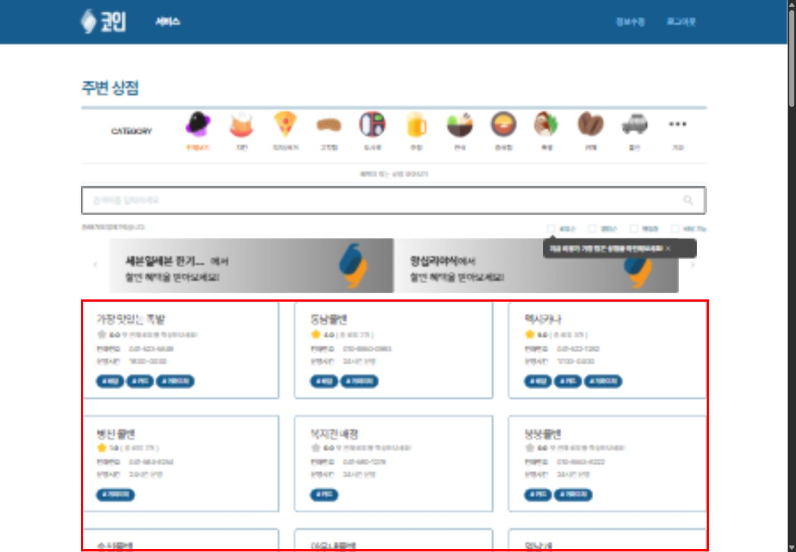
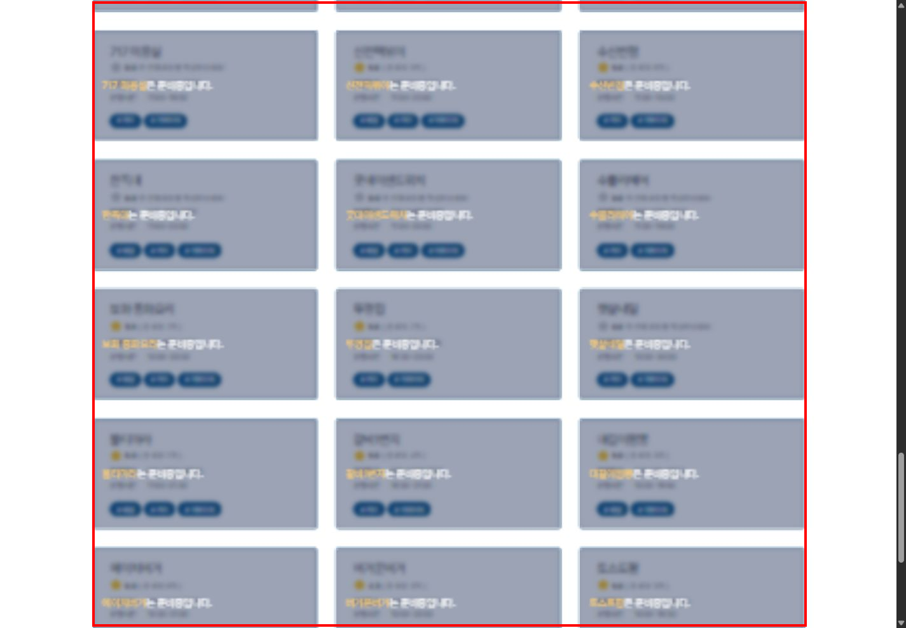
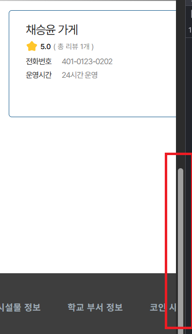

# 2-2 상점 카테고리 (스크롤)

원문 페이지 ID: cea0221954bc820e99cc018b531d5c7a

> 원문 스냅샷. 명세 확정·앱 배포·수집 완료를 뜻하지 않습니다.

## 원문 속성

```json
{
  "platform": [
    "WEB",
    "ANDROID",
    "IOS"
  ],
  "url": "source-page-id:cea0221954bc820e99cc018b531d5c7a",
  "상태": "완료",
  "생성일": "2026-11-08T10:51:47.737Z",
  "이벤트 이름": "2-2 상점 카테고리 (스크롤)",
  "태그": [
    "2. 상점 카테고리"
  ]
}
```

<details>
<summary>이전 로깅</summary>

<span color="orange">event\_params.key</span>

<ul>
<li>
event\_label : shop\_categories
</li>
<li>
value : scroll in \{카테고리\}   
</li>
<li>
event\_category : scroll
</li>
</ul>


---

<p>
상점 카테고리에서  스크롤 횟수를 파악하고자 하는 이벤트 입니다. 
</p>


---

<h3>
오류사항 
</h3>

<p>
웹: 
</p>

<p>
전체보기에서 스크롤이 안되는 상황 
</p>

---

[해결 (1)](4f30221954bc83a58b0601b95bea2381.md)
</details>

<details>
<summary>새 로깅 (26.10.17)</summary>

- 설명: 상점 목록 화면에서 상점 목록을 스크롤하는 경우 (스크롤 횟수 파악용)
- screen\_view: <code>shop_list</code>
- event\_name: <code>DA1</code>
- event\_label: <code>shop__shop_list__shop_list__scroll</code>
- value: \{현재 카테고리\} → 전체보기 / 치킨 / 피자/버거 등 (예: 전체보기)
- event\_category: <code>scroll</code>

<details>
<summary>검토사항</summary>

- 사진 재검수 (2026-10-30): WEB 실제 상점 목록을 대표 사진으로 보완했다. 기존 모바일 85×125px 조각은 보조 이력으로 분리했다. 운영 /store?category=1 보라색 모바일 웹을 직접 확인하고 목록 스크롤 대표사진을 보완했다. 네이티브 앱·SDK 발화는 미확인이다.
- 통합 가이드: [로깅 통합 가이드](3c30221954bc8214b1c481c5bbb6fba5.md)
- label DA2 기준 정렬 (2026-10-27): <code>shop__shop_list__list__scroll</code> → <code>shop__shop_list__shop_list__scroll</code>
</details>

### 참고사진 (상점 목록 스크롤)

<columns>
<column ratio="50">
<b>웹</b>

<details>
<summary>스크롤 전후 · 운영 WEB (2026-10-30)</summary>

출처: [koreatech.in](http://koreatech.in) 실제 주변상점 목록 화면. 빨간 테두리=목록 영역. 실제 스크롤 후 화면 위치를 비교하는 참고자료이며 SDK 이벤트 대상·발화·중복 전송은 미확인이다.





WEB · 스크롤 전 · 2026-10-30.





WEB · 스크롤 후 · 2026-10-30.

</details>

<details>
<summary>교체 전 참고사진 · 웹 (이력)</summary>

웹 — 상점 목록 스크롤 (출처: 기존 캡처)


</details>
</column>
<column ratio="50">
<b>모바일</b>

<details>
<summary>참고사진 · 모바일</summary>


</details>
</column>
</columns>
</details>
