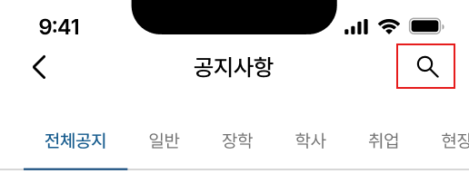
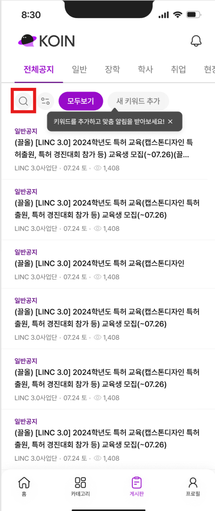

# 6-1. 공지글 검색_클릭

원문 페이지 ID: cec0221954bc83fb80878101caf9ec11

> 원문 스냅샷. 명세 확정·앱 배포·수집 완료를 뜻하지 않습니다.

## 원문 속성

```json
{
  "platform": [
    "ANDROID",
    "IOS"
  ],
  "url": "source-page-id:cec0221954bc83fb80878101caf9ec11",
  "상태": "로깅 필요",
  "이름": "6-1. 공지글 검색\\_클릭",
  "태그": [
    "6. 공지글 검색(APP)"
  ]
}
```

<details>
<summary>이전 로깅</summary>




</details>

<details>
<summary>새 로깅 (26.10.05) — 초안</summary>

- 설명: 공지사항 목록 상단의 돋보기 버튼을 눌러 공지글 검색 화면 진입.
- screen\_view: <code>main_notice</code>
- event\_name: <code>DA2</code>
- event\_label: <code>board__main_notice__search__entry__click</code>
- value: 공지글 검색
- event\_category: <code>click</code>

<details>
<summary>검토사항</summary>

- label 통일 (2026-10-27): <code>board__main_notice__search__entry</code> → <code>board__main_notice__search__entry__click</code>
</details>

<details>
<summary>참고사진 · 모바일</summary>

<b>모바일</b>


</details>
</details>
