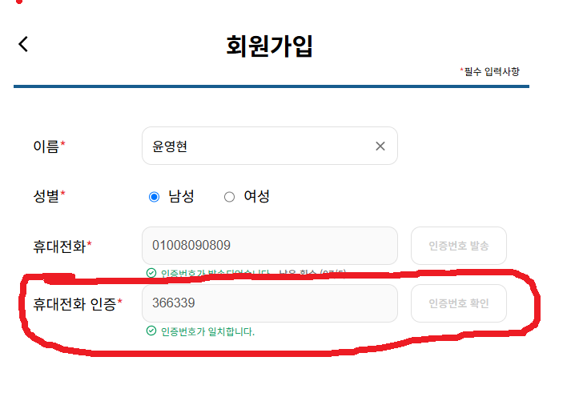
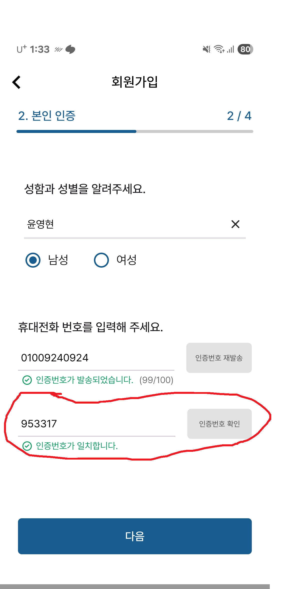
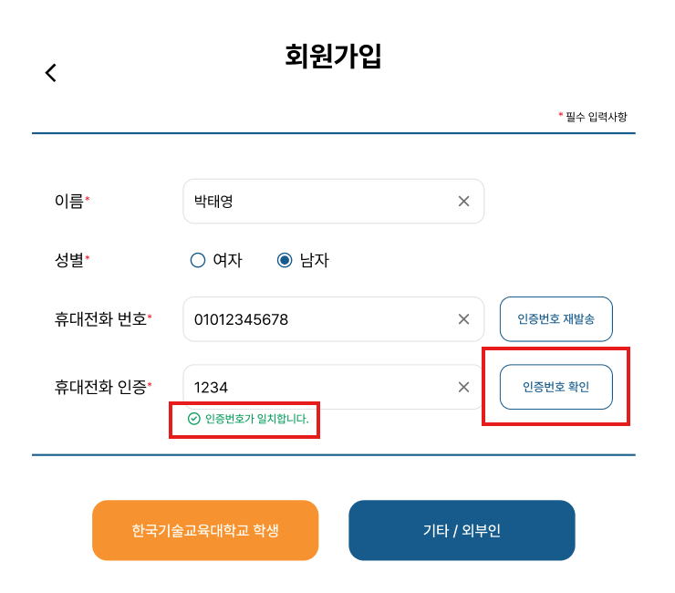
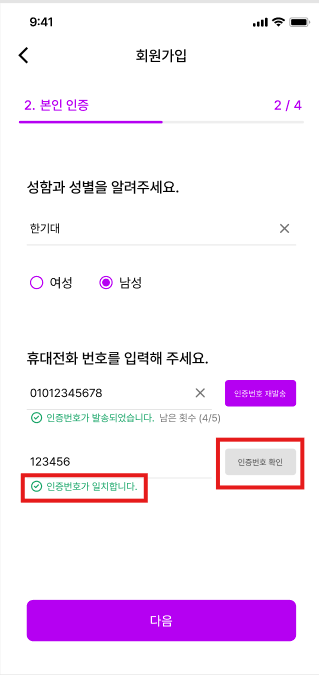

# 1-6 본인인증_인증완료

원문 페이지 ID: d000221954bc837d8b7401f9db0853cb

> 원문 스냅샷. 명세 확정·앱 배포·수집 완료를 뜻하지 않습니다.

## 원문 속성

```json
{
  "platform": [
    "ANDROID",
    "IOS",
    "WEB"
  ],
  "url": "source-page-id:d000221954bc837d8b7401f9db0853cb",
  "구분": "본인인증",
  "상태": "로깅 필요",
  "생성일": "2026-11-08T10:51:25.852Z",
  "이벤트 이름": "1-6 본인인증\\_인증완료",
  "태그": [
    "회원가입"
  ]
}
```

<details>
<summary>이전 로깅</summary>

- event\_label : “identity\_verification”
- value : “인증완료<b>”</b>
- event\_category : “click”
- custom\_session\_id : \{sign\_up\}\_\{0\}\_\{플랫폼\}\_\{세션시작시간\}\_\{랜덤값\}

인증번호 확인 클릭이 아닌

인증번호가 일치한 순간에만 로깅


<p>
인증번호 불일치 → 로깅 X 
</p>


<b>웹</b>




<b>모바일</b>




</details>

<details>
<summary>새 로깅 (26.10.04)</summary>

- 설명: 입력한 인증번호가 일치한 순간에만 기록한다. 인증번호 확인 버튼 클릭만으로 전송하지 않고 불일치 시에는 기록하지 않는다.
- event\_name: <code>DA2</code>
- screen\_view: <code>identity_verification</code>
- event\_label: <code>account__identity_verification__sign_up__code_verify_success__click</code>
- value: 인증완료
- event\_category: <code>click</code>
- custom\_session\_id : \{sign\_up\}\_\{0\}\_\{플랫폼\}\_\{세션시작시간\}\_\{랜덤값\}

인증번호 확인 클릭이 아닌

인증번호가 일치한 순간에만 로깅

<p>
인증번호 불일치 → 로깅 X 
</p>

<details>
<summary>검토사항</summary>

- label 통일 (2026-10-27): <code>account__identity_verification__sign_up__code_verify_success</code> → <code>account__identity_verification__sign_up__code_verify_success__click</code>
</details>

<details>
<summary>참고사진 (기능 표시)</summary>

<b>웹</b>



<b>모바일</b>


</details>
</details>
