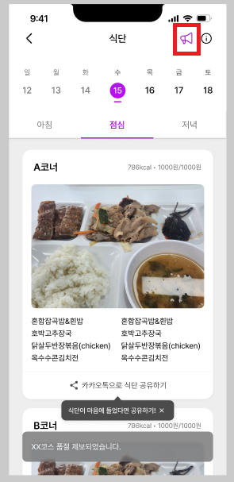
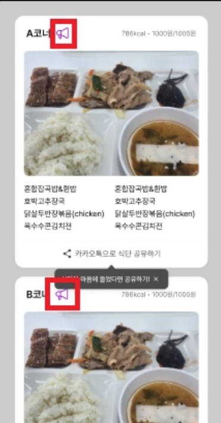

# 2. 품절 제보 버튼_버튼 클릭

원문 페이지 ID: d090221954bc820080f301bf87b26e96

> 원문 스냅샷. 명세 확정·앱 배포·수집 완료를 뜻하지 않습니다.

## 원문 속성

```json
{
  "platform": [
    "ANDROID",
    "IOS",
    "WEB"
  ],
  "url": "source-page-id:d090221954bc820080f301bf87b26e96",
  "상태": "로깅 필요",
  "생성일": "2026-11-08T10:51:35.371Z",
  "이름": "2\\. 품절 제보 버튼\\_버튼 클릭",
  "태그": [
    "0. A/B TEST"
  ]
}
```

<details>
<summary>이전 로깅</summary>

없음 (새로 추가한 로깅)
</details>

<details>
<summary>새 로깅 (26.10.17)</summary>

- screen\_view: <code>cafeteria</code>
- event\_name: <code>DA1</code>
- event\_label: <code>cafeteria__dining__soldout__start</code>
- value:
  - A안
  - B안\_\{A코너 or B코너 등등\}
- event\_category: <code>click</code>

<details>
<summary>검토사항</summary>

- 이미 구현 완료된 명세 — 수정 금지 (2026-10-27 사용자 확인). value 표기는 원문대로 복원.
- 통합 가이드·후속: [로깅 통합 가이드](3c30221954bc8214b1c481c5bbb6fba5.md)
- 설명 항목이 원본(개인 Event Log)에도 없어 비워 둠. 작성 필요
- 참고사진(A안/B안 시안)은 사진 플랫폼 확인 완료 (이미지 비율 기준: 모바일, 295x607 / 372x711, 앱 시안이라 모바일 칸으로 옮김)
</details>

### 참고사진 (품절 제보 버튼 클릭)

<columns>
<column ratio="50">
<b>웹</b>

<details>
<summary>참고사진 · 웹</summary>

웹 — 사진 없음 (추가 필요)
</details>
</column>
<column ratio="50">
<b>모바일</b>

<details>
<summary>참고사진 · 모바일</summary>

모바일 — A안 시안



모바일 — B안 시안


</details>
</column>
</columns>
</details>


