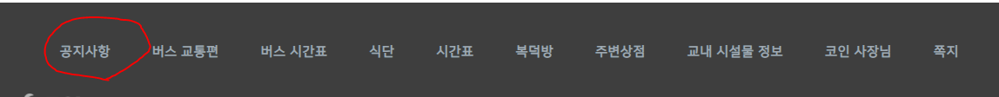

# 2-2. 푸터_공지사항_클릭

원문 페이지 ID: d090221954bc82ef91ed81fe49980a28

> 누락 원본 복구 스냅샷. 원본의 과거값·검토 기록을 보존하며 생성 계약으로 자동 승인하지 않습니다.

대조 기록: [87개 원본 복구 및 8개 차이 정리](../recovery-review.md)

관련 기존 보관본: [2-2. 푸터_공지사항_클릭](e280221954bc833ba2d5010881c890de.md), [2-2. 푸터_공지사항_클릭](0a90221954bc82898d4d8125f9edc616.md)

## 원문 속성

```json
{
  "platform": [
    "WEB"
  ],
  "url": "source-page-id:d090221954bc82ef91ed81fe49980a28",
  "상태": "완료",
  "이름": "2-2. 푸터\\_공지사항\\_클릭"
}
```

- 설명: 푸터 에서 공지사항 클릭
- event\_label : “footer”
- value : “공지사항”
- event\_category : “click”
- 참고사진



