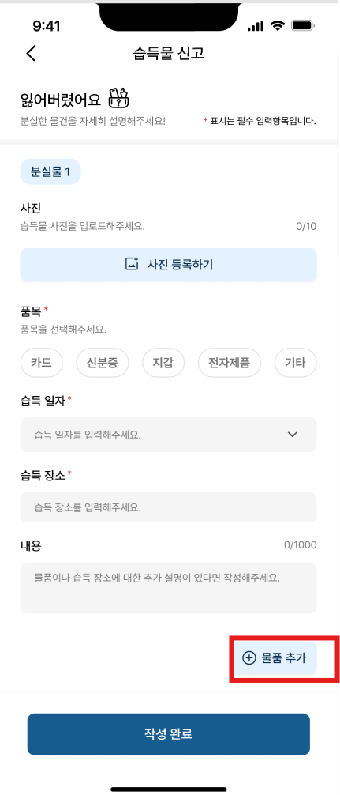
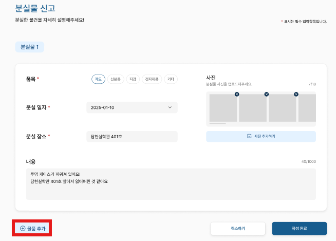
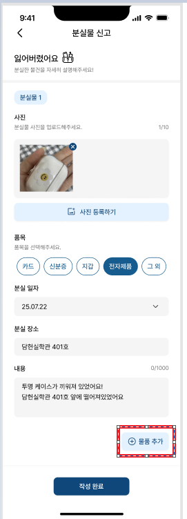
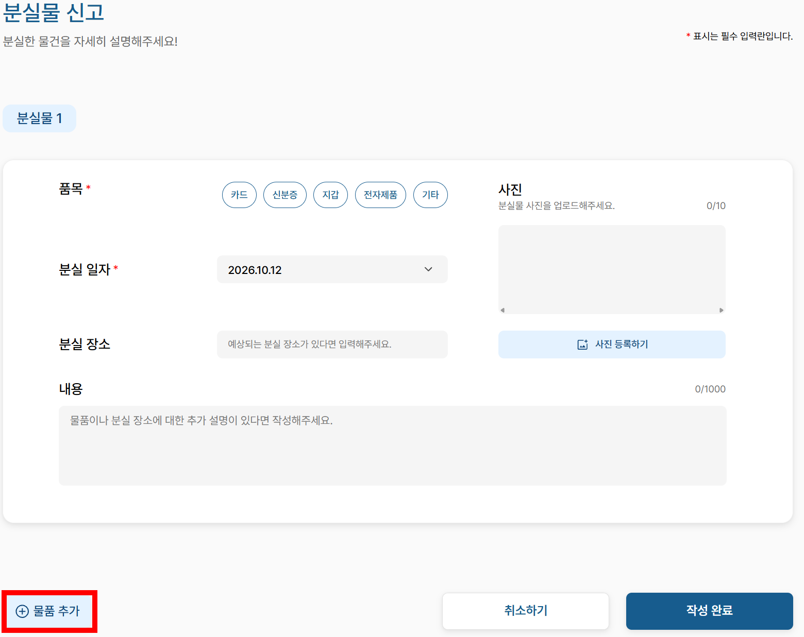
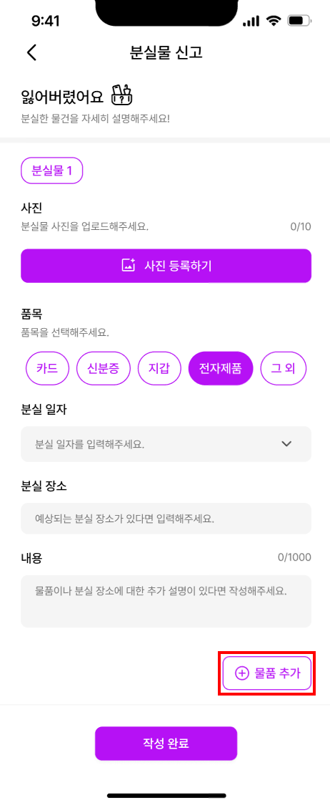

# 11-10.분실물_분실물신고_물품추가_클릭

원문 페이지 ID: d1e0221954bc8256aa1381a13a98a332

> 원문 스냅샷. 명세 확정·앱 배포·수집 완료를 뜻하지 않습니다.

## 원문 속성

```json
{
  "platform": [
    "ANDROID",
    "IOS",
    "WEB"
  ],
  "url": "source-page-id:d1e0221954bc8256aa1381a13a98a332",
  "상태": "완료",
  "이름": "11-10.분실물\\_분실물신고\\_물품추가\\_클릭",
  "태그": [
    "11.분실물"
  ]
}
```

<details>
<summary>과거 로깅</summary>

- 설명: 분실물 신고 글쓰기 페이지에서 물품 추가를 클릭
- event\_label : “lost\_item\_add\_item”
- value : “물품 추가”
- event\_category : “click”
- 참고사진





<b>이전 참고사진</b>

mobile\_view, mobile\_Web\_view



WEB : 예시 화면이 습득물 신고인데 분실물 신고랑 기능이 동일해서 넣었습니다.


</details>

<details>
<summary>새 로깅</summary>

- 설명: 분실물 신고 글쓰기 페이지에서 물품 추가를 클릭
- screen\_view: <code>lost_item_write</code>
- event\_name: <code>DA2</code>
- event\_label: <code>board__lost_item_write__lost_item_write__item_add__click</code>
- value: 물품 추가
- event\_category: <code>click</code>

### 참고사진 (기능 표시)

<columns>
<column ratio="50">
<b>웹</b>

<b>참고사진 · 웹</b>

웹 — 분실물 물품 추가


</column>
<column ratio="50">
<b>모바일</b>

<b>참고사진 · 모바일</b>

모바일 — 분실물 물품 추가


</column>
</columns>
</details>
