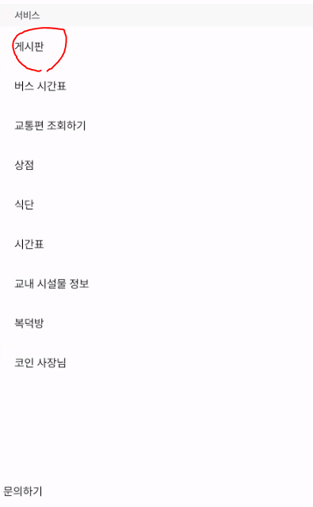
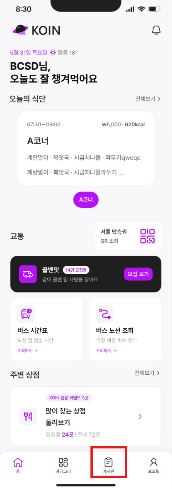

# 2-3. 공지사항_클릭 (레거시)

원문 페이지 ID: d300221954bc8330be2381687a8f27c1

> 원문 스냅샷. 명세 확정·앱 배포·수집 완료를 뜻하지 않습니다.

## 원문 속성

```json
{
  "platform": [
    "ANDROID",
    "IOS"
  ],
  "url": "source-page-id:d300221954bc8330be2381687a8f27c1",
  "상태": "로깅 필요",
  "이름": "2-3. 공지사항\\_클릭 (레거시)",
  "태그": [
    "2. 헤더/푸터/햄버거_공지사항"
  ]
}
```

<callout icon="📁" color="gray_bg">
<b>레거시 보존 · 현행 새 로깅은 홈으로 이관</b>

- 2026-11-04 사용자 지시로 이 페이지는 이력만 보존한다.
- 현행 기준 명세: [2-3 네비게이션 바 게시판 클릭](e720221954bc8366ab190191154be107.md).
- 이관 후 event\_label: <code>main__main__notice_entry__navigation_entry__click</code>. 아래 이관 전 라벨·값·사진은 보존 기록이며 별도 신규 구현·추가 전송 대상으로 사용하지 않는다.
- 실제 SDK 전환·배포·수집 중단 여부는 미확인이다. 기존 플랫폼과 상태 속성은 유지했다.
</callout>

<details>
<summary>이전 로깅</summary>

- 설명: 햄버거 에서 공지사항(게시판) 클릭
- event\_label : “hamburger”
- value : “공지사항”
- event\_category : “click”
- 참고사진


</details>

<details>
<summary>이관 전 새 로깅 (26.10.05) — 레거시 보존</summary>

- 설명: 앱 하단 네비게이션 바에서  공지사항(게시판) 항목 클릭.
- screen\_view: <code>main</code>
- event\_name: <code>DA2</code>
- event\_label: <code>board__main__notice_entry__navigation_entry__click</code>
- value: “공지사항”
- event\_category: <code>click</code>

<details>
<summary>검토사항</summary>

- label 통일 (2026-10-27): <code>board__main__notice_entry__navigation_entry</code> → <code>board__main__notice_entry__navigation_entry__click</code>
</details>

<details>
<summary>참고사진 · 모바일</summary>

<b>모바일</b>


</details>


</details>


