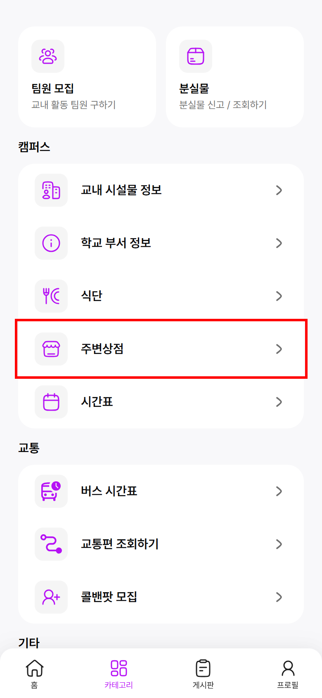

# 1-5 카테고리 → 주변상점 (클릭)

원문 페이지 ID: d330221954bc83ffb1e6814b565790bc

> 원문 스냅샷. 명세 확정·앱 배포·수집 완료를 뜻하지 않습니다.

## 원문 속성

```json
{
  "platform": [
    "IOS",
    "ANDROID",
    "WEB (모바일)"
  ],
  "url": "source-page-id:d330221954bc83ffb1e6814b565790bc",
  "상태": "완료",
  "생성일": "2026-11-08T10:51:49.292Z",
  "이벤트 이름": "1-5 카테고리 → 주변상점 (클릭)",
  "태그": [
    "1. 메인 -> 카테고리"
  ]
}
```

<details>
<summary>이전 로깅</summary>

- 없음 (새로 추가한 로깅)
</details>

<details>
<summary>새 로깅 (26.10.17)</summary>

- 설명: 카테고리에서 주변 상점 클릭
- screen\_view: <code>main_category</code>
- event\_name: <code>DA1</code>
- event\_label: <code>shop__main_category__shop_entry__category_entry__click</code>
- value: 주변상점
- event\_category: <code>click</code>

<details>
<summary>검토사항</summary>

- 통합 가이드: [로깅 통합 가이드](3c30221954bc8214b1c481c5bbb6fba5.md)
- 웹은 모바일 버전(웹 모바일 뷰)만 존재.
- label DA2 기준 정렬 (2026-10-27): <code>shop__main_category__entry__click</code> → <code>shop__main_category__shop_entry__category_entry__click</code>
</details>

### 참고사진 (카테고리 → 주변상점 클릭)

<columns>
<column ratio="50">
<b>웹</b>

<details>
<summary>참고사진 · 웹</summary>

해당 없음 (이 계약은 모바일 카테고리 화면용)

데스크톱 WEB 리디자인의 생활편의 → 주변 상점은 [1-3 헤더 → 주변상점 (클릭)](a340221954bc82719a5d0107aaa80cb3.md)의 헤더 진입 계약과 사진을 따른다. 같은 버튼에 이 모바일 카테고리 라벨을 함께 보내지 않는다. 기존 모바일 사진·플랫폼·라벨은 유지한다.
</details>
</column>
<column ratio="50">
<b>모바일</b>

<details>
<summary>참고사진 · 모바일</summary>

모바일 — 카테고리 → 주변상점 클릭 (출처: stage 실제 캡처, 빨간 네모 = 클릭 위치)


</details>
</column>
</columns>
</details>
