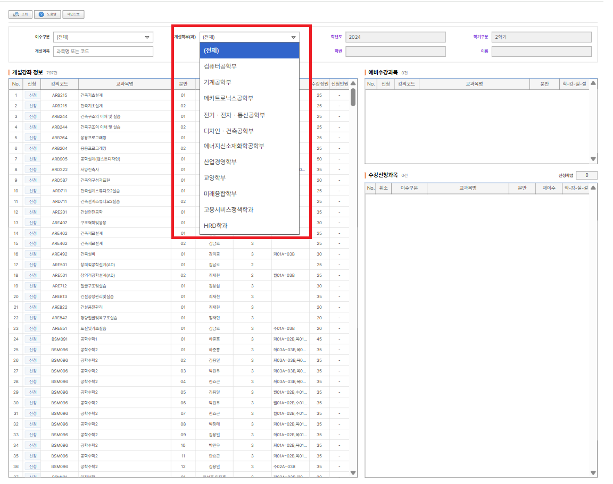
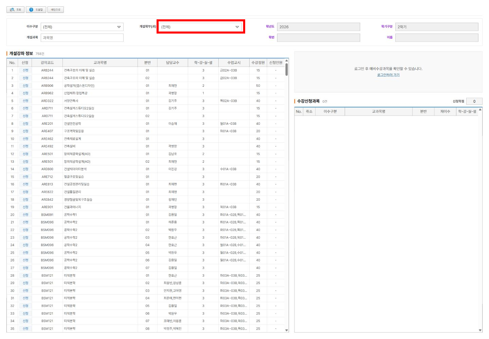

# 1-1. 모의수강신청_개설학부(과) 선택

원문 페이지 ID: d360221954bc83d2a775010fef63a378

> 원문 스냅샷. 명세 확정·앱 배포·수집 완료를 뜻하지 않습니다.

## 원문 속성

```json
{
  "platform": [
    "WEB"
  ],
  "url": "source-page-id:d360221954bc83d2a775010fef63a378",
  "상태": "로깅 필요",
  "이름": "1-1. 모의수강신청\\_개설학부(과) 선택",
  "태그": [
    "1. 모의수강신청_메인화면"
  ]
}
```

<details>
<summary>이전 로깅</summary>

- event\_label : “application\_training<span color="blue">\_all</span>”
- value: \{”학부 명”\}
- event\_category : “click”
- 참고 이미지




</details>

<details>
<summary>새 로깅 (2026-10-14) — 초안</summary>

- 설명: 모의수강신청 화면에서 개설학부(과) 드롭다운에서 학부를 선택한다.
- screen\_view: <code>course_practice</code>
- event\_label: <code>course_practice__course_practice__search__department__click</code>
- event\_name: <code>DA2</code>
- value: \{학부 명\}
- event\_category: <code>click</code>

<details>
<summary>검토사항</summary>

- 방식 A 반영 (2026-10-28 사용자 확인): 승인된 기존 event\_category <code>click</code>을 복원하고 label 마지막 구간을 일치시켰다. <code>course_practice__course_practice__search__department__select</code> → <code>course_practice__course_practice__search__department__click</code>. label 끝에 맞춰 category를 바꾼 과거 후속 메모는 이 결정으로 대체한다. 기존 value·event\_name·플랫폼·전송 시점은 유지하며 성공/실패 이벤트를 새로 만들지 않는다.
- label 통일 (2026-10-27): <code>course_practice__course_practice__search__department_select</code> → <code>course_practice__course_practice__search__department__select</code>
- 승인 category 복원 확인 (2026-10-28): 이전 사용자 방식 A 승인에 따라 기존 click을 유지한다. label 끝 단어만 click에 맞추며, category를 select/submit/toggle로 변경하라는 과거 후속 메모는 철회한다.
</details>

### 참고사진 (기능 표시)

<b>웹(데스크톱)</b>

<details>
<summary>참고사진 · 웹</summary>

화면 정의의 실제 데스크톱 웹 캡처(2026-10-13). 이번 작업은 기존 캡처를 사용. 비로그인 상태.


</details>
</details>
