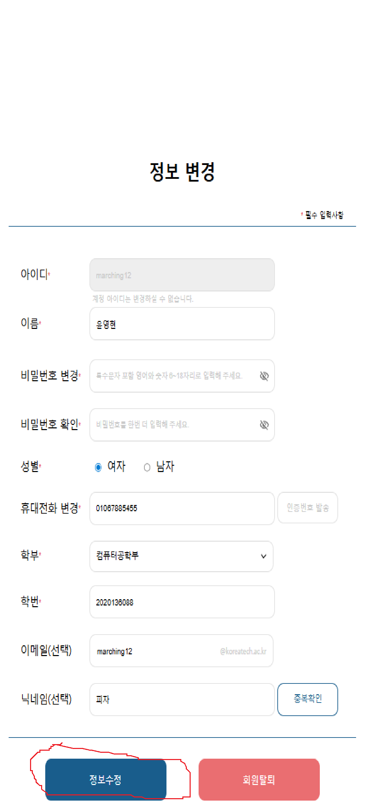
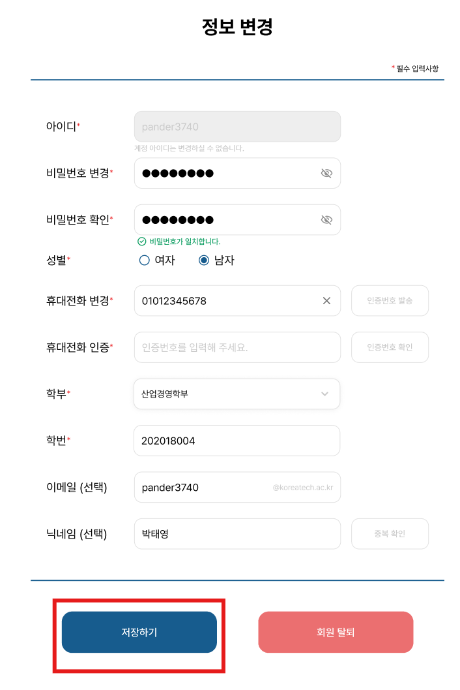
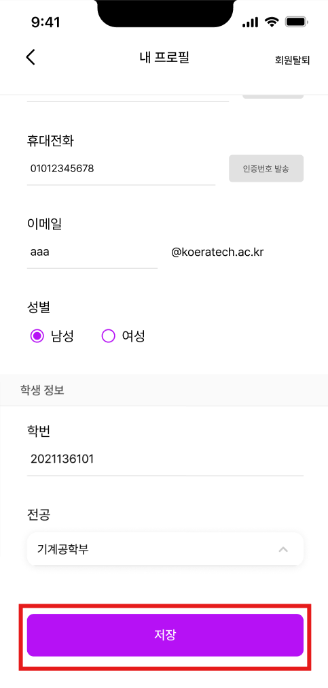

#  3-3 정보수정완료(클릭)

원문 페이지 ID: d470221954bc83398adf814f1989727f

> 원문 스냅샷. 명세 확정·앱 배포·수집 완료를 뜻하지 않습니다.

## 원문 속성

```json
{
  "platform": [
    "ANDROID",
    "IOS",
    "WEB"
  ],
  "url": "source-page-id:d470221954bc83398adf814f1989727f",
  "구분": "정보수정",
  "상태": "로깅 필요",
  "생성일": "2026-11-08T10:51:28.748Z",
  "이벤트 이름": "<p>\n 3-3 정보수정완료(클릭)\n</p>",
  "태그": [
    "정보수정"
  ]
}
```

<details>
<summary>이전 로깅</summary>

- event\_label : “user\_info”
- value : “정보수정 완료 or 정보수정 실패<b>”</b>
- event\_category : “click”


웹




모바일


비밀번호 변경에도 심어주세요 ㅎㅎ


</details>

<details>
<summary>새 로깅 (26.10.04)</summary>

- 설명: 정보수정 화면에서 기존 수정 완료·실패 처리 조건에 따라 기록한다. 기존 전송 시점과 성공·실패 value를 유지한다.
- event\_name: <code>DA2</code>

<callout icon="☝" color="gray_bg">
비밀번호 변경 시 로깅이 변경되었습니다.
</callout>

- screen\_view: <code>edit_profile</code>
- event\_label: <code>account__edit_profile__profile_edit__confirm__click</code>
- value: 정보수정 완료 또는 정보수정 실패
- event\_category: <code>click</code>

<details>
<summary>검토사항</summary>

- label DA2 기준 정렬 (2026-10-27): <code>account__edit_profile__profile_edit__submit</code> → <code>account__edit_profile__profile_edit__confirm__click</code>
- 기존 event\_category click과 전송 시점·성공/실패 value는 유지한다. confirm은 기존 완료/시도 동작을 구분하는 detail이며, 성공 이벤트를 새로 만들지 않는다.
</details>

<details>
<summary>참고사진 · 웹</summary>

<b>웹</b>


</details>

<details>
<summary>참고사진 · 모바일</summary>

<b>모바일</b>


</details>
</details>


