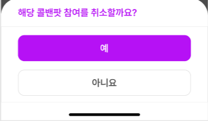
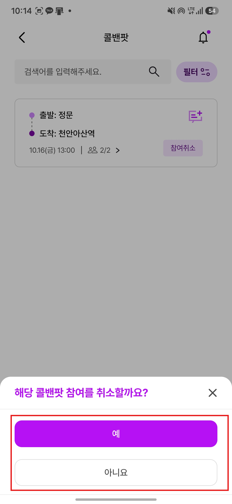

# 2-5  콜밴팟 참여 취소하기

원문 페이지 ID: d4b0221954bc83dcbf2581ae2583d220

> 원문 스냅샷. 명세 확정·앱 배포·수집 완료를 뜻하지 않습니다.

## 원문 속성

```json
{
  "platform": [
    "ANDROID",
    "IOS"
  ],
  "url": "source-page-id:d4b0221954bc83dcbf2581ae2583d220",
  "상태": "로깅 필요",
  "이름": "2-5  콜밴팟 참여 취소하기",
  "태그": [
    "2. 콜밴팟 찾기"
  ]
}
```

<details>
<summary>이전 로깅</summary>


- event\_name : CAMPUS
- event\_category : click
- event\_label : callvan\_join\_cancel
- value : 예, 아니요



</details>

<details>
<summary>새 로깅 (2026-10-14) — 초안</summary>

- 설명: 목록에서 참여취소로 연 확인 모달의 예 또는 아니요를 클릭한다.
- screen\_view: <code>callvan_list</code>
- event\_label: <code>callvan__callvan_list__callvan_participation__cancel_response__click</code>
- event\_name: <code>DA2</code>
- value: 예, 아니요
- event\_category: <code>click</code>
- 발생 시점 확정: 참여 취소 확인 모달의 ‘예’ 또는 ‘아니오’ 확인 응답 버튼을 클릭하는 순간 전송한다. 2-4와 동일한 응답 시점이다. 취소 모달 열기나 서버 성공 응답에서는 이 이벤트를 추가 전송하지 않는다. 기존 응답 value는 유지한다.

<details>
<summary>검토사항</summary>

- label 통일 (2026-10-27): callvan\_\_callvan\_list\_\_callvan\_participation\_\_cancel\_response → callvan\_\_callvan\_list\_\_callvan\_participation\_\_cancel\_response\_\_click
</details>

### 참고사진 (기능 표시)

<b>모바일 (ANDROID, IOS) / 캡처 출처는 아래 참조</b>

<details>
<summary>참고사진 · 모바일</summary>

사용자가 실제 화면으로 교체 완료한 사진(2026-10-16). 현재 첨부 이미지를 유지한다.


</details>
</details>
