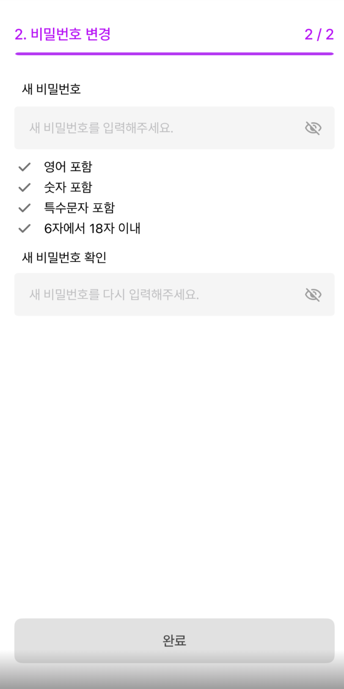

#  3-4 비밀번호수정완료(클릭)

원문 페이지 ID: d4c0221954bc8357a10b81b3f8e521ea

> 원문 스냅샷. 명세 확정·앱 배포·수집 완료를 뜻하지 않습니다.

## 원문 속성

```json
{
  "platform": [
    "ANDROID",
    "IOS"
  ],
  "url": "source-page-id:d4c0221954bc8357a10b81b3f8e521ea",
  "구분": "정보수정",
  "상태": "로깅 필요",
  "생성일": "2026-11-12T05:07:32.215Z",
  "이벤트 이름": "<p>\n 3-4 비밀번호수정완료(클릭)\n</p>",
  "태그": [
    "정보수정"
  ]
}
```

<details>
<summary>과거 로깅</summary>

- event\_label : “user\_info”
- value : “정보수정 완료 or 정보수정 실패<b>”</b>
- event\_category : “click”


웹


모바일


비밀번호 변경에도 심어주세요 ㅎㅎ


</details>

<details>
<summary>새 로깅</summary>

- 설명: 정보수정을 통한 비밀번호 변경의 기존 완료·실패 처리 조건에 따라 기록한다. WEB·모바일 모두 논리 화면 password\_change를 사용하며 비밀번호 찾기 경로와 구분한다. 기존 전송 시점과 성공·실패 value는 유지한다.
- event\_name: <code>DA2</code>
- screen\_view: <code>password_change</code>
- event\_label: <code>account__password_change__password_change__confirm__click</code>
- value: 비밀번호 수정 완료 또는 비밀번호 수정 실패
- event\_category: <code>click</code>

<b>참고사진 · 모바일</b>

<b>모바일</b>




</details>


