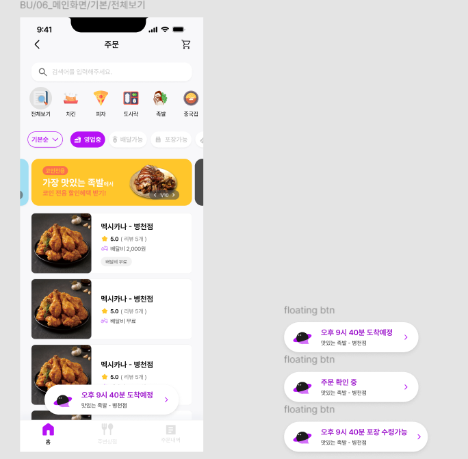

# 2-19 상점 카테고리 → 플로팅 바

원문 페이지 ID: d4d0221954bc8249adc801bd175edf35

> 원문 스냅샷. 명세 확정·앱 배포·수집 완료를 뜻하지 않습니다.

## 원문 속성

```json
{
  "url": "source-page-id:d4d0221954bc8249adc801bd175edf35",
  "상태": "로깅 필요",
  "생성일": "2026-11-08T10:51:28.755Z",
  "이벤트 이름": "2-19 상점 카테고리 → 플로팅 바",
  "태그": [
    "2. 상점 카테고리"
  ]
}
```





<span color="orange">event\_params.key</span>

<ul>
<li>
event\_label : shop\_categories\_floating
</li>
<li>
value : 
</li>
<li>
event\_category : 

<ul>
<li>
click 
</li>
</ul>
</li>
<li>
duration\_time : 
</li>
<li>
previous\_page : 
</li>
<li>
current\_page : 
</li>
</ul>
