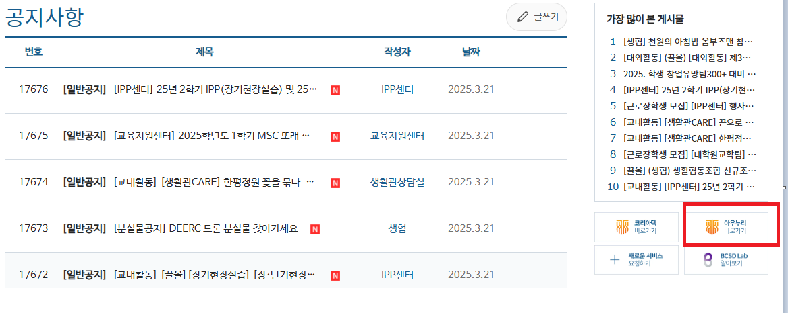

# 3-3. 공지사항_아우누리 바로가기_클릭

원문 페이지 ID: d540221954bc83ba95c7015aa20d2937

> 원문 스냅샷. 명세 확정·앱 배포·수집 완료를 뜻하지 않습니다.

## 원문 속성

```json
{
  "platform": [
    "WEB"
  ],
  "url": "source-page-id:d540221954bc83ba95c7015aa20d2937",
  "상태": "레거시",
  "이름": "3-3. 공지사항\\_아우누리 바로가기\\_클릭",
  "태그": [
    "3. 공지사항 상세 페이지"
  ]
}
```

<details>
<summary>이전 로깅</summary>

- 설명: 공지사항 페이지 에서 아우누리 바로가기 클릭
- event\_label : “short\_cut”
- value : “\{바로가기 타이틀\}”
- event\_category : “click”
- 참고사진


</details>

<details>
<summary>새 로깅 (26.10.05) — 초안</summary>

- 설명: 공지사항 화면의 아우누리 바로가기 클릭.
- screen\_view:
- event\_name: <code>DA1</code>
- event\_label: <code>board__notice_list__shortcut__click</code>
- value: “아우누리 바로가기”
- event\_category: <code>click</code>
- 적용 플랫폼: WEB
- 참고사항
  - 3-2\~3-5는 같은 바로가기 기능이므로 event\_label을 공유하고 value로 대상을 구분합니다.
- 참고사진: 이전 로깅의 참고사진 참조
</details>

레거시 사유 : 3-2 공지사항\_바로가기\_클릭으로 통합
