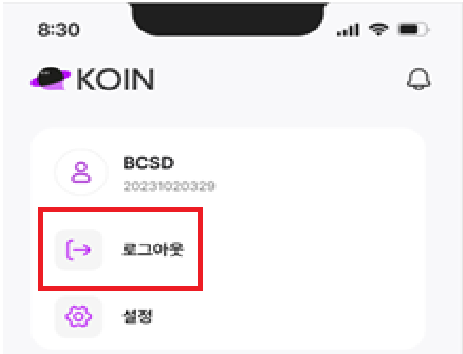
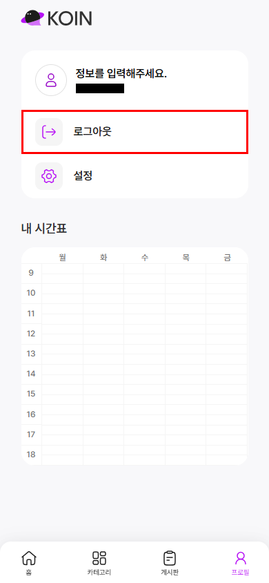

# 4-3 로그아웃 클릭

원문 페이지 ID: d6b0221954bc820288550143b7dce11e

> 원문 스냅샷. 명세 확정·앱 배포·수집 완료를 뜻하지 않습니다.

## 원문 속성

```json
{
  "platform": [
    "ANDROID",
    "IOS"
  ],
  "url": "source-page-id:d6b0221954bc820288550143b7dce11e",
  "구분": "프로필",
  "상태": "완료",
  "생성일": "2026-11-08T10:52:03.306Z",
  "이벤트 이름": "4-3 로그아웃 클릭"
}
```

<callout icon="📌" color="blue_bg">
<b>현행 홈 대표 명세 · 이 페이지의 로깅 유지</b>

2026-11-05 사용자 지시로 프로필 로그아웃는 이 홈 명세를 기준으로 적용한다. [[레거시] 4-2 로그아웃(클릭)](fe30221954bc83949b21014f94991fc3.md)는 레거시 이력이며 별도 신규 구현·추가 전송 대상이 아니다. 아래 이전의 외부 대표 지정·두 문서 공동 계약·별개 유지 설명은 이 결정으로 대체한다. 기존 홈 라벨·value·category·event\_name·screen\_view·플랫폼·사진·발생 조건은 유지한다. SDK 단일 전송은 별도 확인한다.
</callout>

<details>
<summary>이전 로깅</summary>

- event\_label : home\_logout
- value : 로그아웃
- event\_category : click





</details>

<details>
<summary>새 로깅 (2026-10-15) — 초안</summary>

- screen\_view: <code>main_profile</code>
- event\_name: <code>DA2</code>
- event\_label: <code>account__main_profile__logout__click</code>
- value: 로그아웃
- event\_category: <code>click</code>
- 설명: 프로필 화면의 로그아웃 버튼 클릭 시 전송한다. 로그아웃 처리 성공 이벤트를 추가하지 않는다.

<details>
<summary>검토사항</summary>

- WEB 리디자인 참고사진 (2026-11-04): 별도 로그인 후 헤더 상태 프레임의 로그아웃 버튼을 Figma 원본에서 확인하고 빨간 네모로 표시했다. [Figma 시안](https://www.figma.com/design/DPlcYuiFxhyT5ULbqec59i/KOIN-Web?node-id=17614-36124). 실제 SDK 동작·배포는 미확인이다.
- WEB과 앱 진입점 구분: 이 페이지의 기존 <code>main_profile</code> 필드는 앱 프로필용으로 유지한다. 아래 WEB 사진은 별도 헤더 명세 [4-1 로그아웃(클릭)](4c70221954bc8228850881c90ff85e64.md)의 UI 참고다. WEB에는 해당 명세의 <code>header</code> 계약을 따르며 앱 라벨을 그대로 재사용하거나 문서 수만큼 중복 전송하지 않는다. 기존 DB 플랫폼 속성은 변경하지 않았다.
- 동일 이벤트 문서 계약 (2026-11-01): 기준 명세는 [[레거시] 4-2 로그아웃(클릭)](fe30221954bc83949b21014f94991fc3.md), 대응 명세는 [4-3 로그아웃 클릭](d6b0221954bc820288550143b7dce11e.md)다. 프로필 로그아웃 두 문서는 하나의 사용자 클릭을 설명하므로 문서 수만큼 추가·중복 전송하지 않는다. 기존 label·screen\_view·event\_name·value·category·플랫폼은 유지한다. 실제 호출 지점·SDK 전송값·플랫폼별 적용·한 번 전송은 미확인이다.
- 통합 가이드·후속: [로깅 통합 가이드](3c30221954bc8214b1c481c5bbb6fba5.md)
- 기존 본문·사진은 위에 보존했다. 실제 전송값 검수는 별도.
</details>

### 참고사진 (로그아웃 버튼 클릭)

<b>웹</b>

<details>
<summary>참고사진 · 웹 — 대표 명세 참조</summary>

WEB 헤더 사진은 [4-1 로그아웃(클릭)](4c70221954bc8228850881c90ff85e64.md)의 참고사진에서 확인한다. 이 페이지는 APP 프로필 main\_profile 명세이며 WEB 헤더와 구분한다. 동일 WEB 사진의 중복 첨부를 정리했고 모바일 사진과 기존 필드는 유지했다.
</details>

<b>모바일</b>

<details>
<summary>참고사진 · 모바일</summary>





모바일 웹 · 2026-10-30 [stage.koreatech.in/profile의](http://stage.koreatech.in/profile%EC%9D%98) 보라색 실제 로그인 상태 프로필 화면. 빨간 테두리=로그아웃 버튼. 계정 식별 정보는 검은색 마스킹. 실제 로그아웃은 수행하지 않았으며 네이티브 앱과 SDK 발화는 미확인이다.

</details>
</details>
