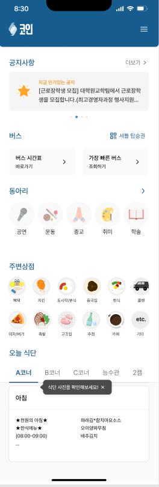
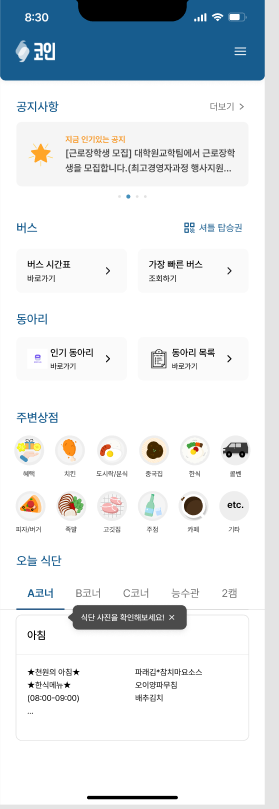

# [레거시] 0.코인_메인화면_동아리진입

원문 페이지 ID: d6f0221954bc83f1abeb012b726641e3

> 원문 스냅샷. 명세 확정·앱 배포·수집 완료를 뜻하지 않습니다.

## 원문 속성

```json
{
  "platform": [
    "ANDROID",
    "IOS"
  ],
  "url": "source-page-id:d6f0221954bc83f1abeb012b726641e3",
  "상태": "레거시",
  "이름": "\\[레거시\\] 0.코인\\_메인화면\\_동아리진입",
  "태그": [
    "0. 메인화면_a/b test"
  ]
}
```

<callout icon="🗃️" color="gray_bg">
<b>레거시 — 동아리 로깅 전체 현행 적용 제외</b>

- 2026-11-04 사용자 지시로 동아리 로깅 전체를 레거시로 보존한다. 이 페이지는 신규 구현·추가 전송·새 네이밍 적용의 기준이 아니다.
- 기존 event\_name·event\_label·value·category·사진·플랫폼과 원문을 그대로 보존한다. 새 라벨을 만들거나 DA1/DA2로 재배정하지 않는다.
- 서비스 전체 기준: [동아리 (레거시)](95f0221954bc835bb9aa8168f3972017.md). 실제 SDK 수집 종료 여부는 별도 확인 대상이다.
</callout>

- 설명: 사용자가 앱을 키는 순간 생성되는 이벤트입니다.
- event\_name : “AB\_TEST”
- event\_category : “a/b test 로깅(메인화면 동아리 진입)”
- event\_label : “CAMPUS\_club\_1”
- value : design\_A / design\_B


- A안




- B안


