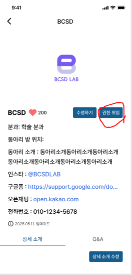
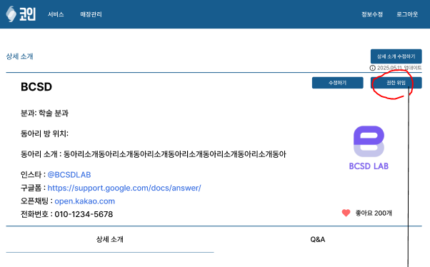

# 5-4.동아리_권한위임 클릭

원문 페이지 ID: d770221954bc831aafc60183b0ba49f7

> 필터 밖 원본 행 복구 스냅샷. 중복·빈 페이지도 원본 ID와 속성, 본문을 개별 보존합니다. 명세 승인이나 앱 적용 완료를 뜻하지 않습니다.

대조 기록: [숨겨진 원본 42개 복구](../hidden-recovery.md)

관련 기존 보관본: [레거시 5-4.동아리_권한위임 클릭](f6f0221954bc82be861101a700e75959.md), [레거시 5-4.동아리_권한위임 클릭](8350221954bc829bbe2e01ec80ebf5a2.md)

## 원문 속성

```json
{
  "platform": [
    "ANDROID",
    "IOS",
    "WEB"
  ],
  "url": "source-page-id:d770221954bc831aafc60183b0ba49f7",
  "상태": "완료",
  "이름": "5-4.동아리\\_권한위임 클릭"
}
```

<ul>
<li>
설명: 동아리 소개 화면에서 권한위임 버튼 클릭
</li>
<li>
event\_name : “CAMPUS”
</li>
<li>
event\_label : “club\_delegation\_authority”
</li>
<li>
value : “권한위임”
</li>
<li>
event\_category : “click” 
</li>
<li>
참고사진
</li>
</ul>





- 웹 참고사진



