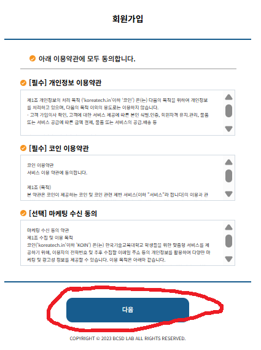
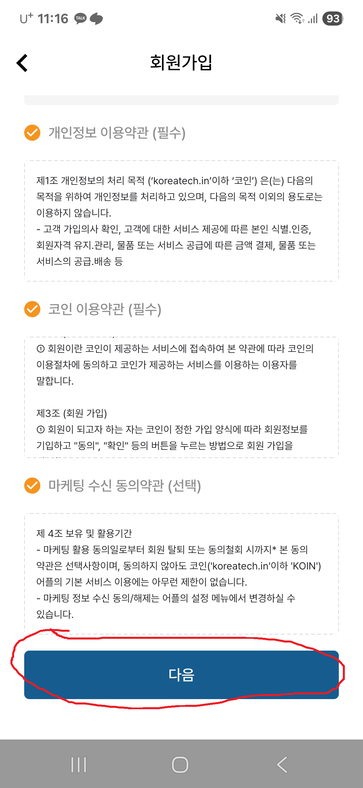
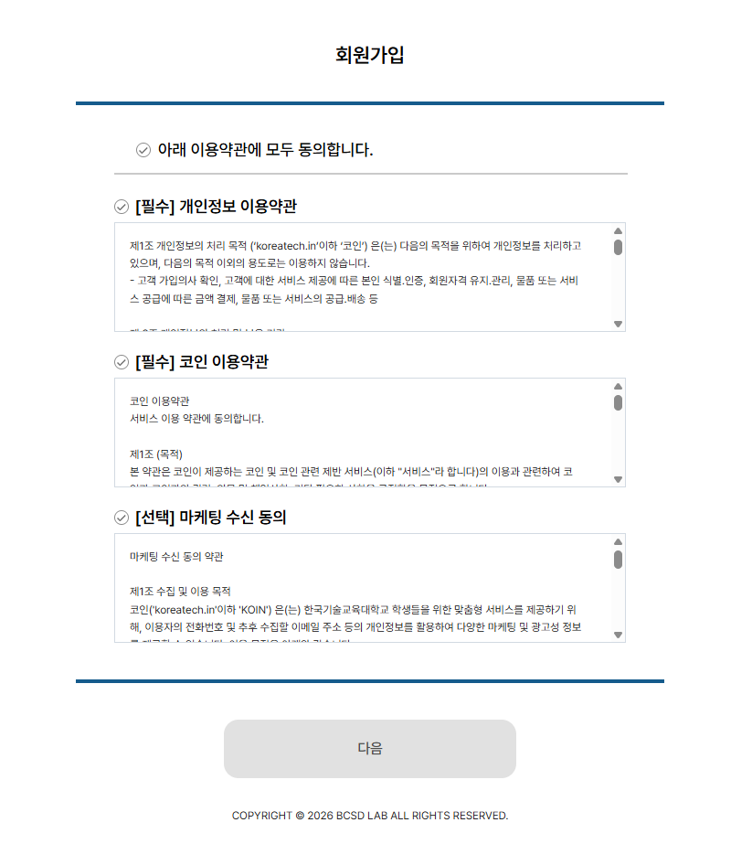
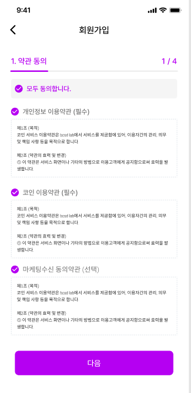

# 1-4 약관동의(클릭)

원문 페이지 ID: d810221954bc8392b4c4016f9aa91548

> 원문 스냅샷. 명세 확정·앱 배포·수집 완료를 뜻하지 않습니다.

## 원문 속성

```json
{
  "platform": [
    "ANDROID",
    "IOS",
    "WEB"
  ],
  "url": "source-page-id:d810221954bc8392b4c4016f9aa91548",
  "구분": "약관동의",
  "상태": "로깅 필요",
  "생성일": "2026-11-08T10:51:23.867Z",
  "이벤트 이름": "1-4 약관동의(클릭)",
  "태그": [
    "회원가입"
  ]
}
```

<details>
<summary>이전 로깅</summary>

- event\_label : “terms\_agreement”
- value : “약관동의<b>”</b>
- event\_category : “click”
- custom\_session\_id : \{sign\_up\}\_\{0\}\_\{플랫폼\}\_\{세션시작시간\}\_\{랜덤값\}

<b>웹</b>




<b>모바일</b>


</details>

<details>
<summary>새 로깅 (26.10.04)</summary>

- 설명: 회원가입 약관동의 화면에서 기존 약관동의 동작을 기록한다. 승인된 클릭 시점과 value를 유지한다.
- event\_name: <code>DA2</code>
- screen\_view: <code>sign_up_policy</code>
- event\_label: <code>account__sign_up_policy__sign_up__terms_agree__click</code>
- value: 약관동의
- event\_category: <code>click</code>
- custom\_session\_id : \{sign\_up\}\_\{0\}\_\{플랫폼\}\_\{세션시작시간\}\_\{랜덤값\}

<details>
<summary>검토사항</summary>

- label 통일 (2026-10-27): <code>account__sign_up_policy__sign_up__terms_agree_click</code> → <code>account__sign_up_policy__sign_up__terms_agree__click</code>
</details>

<details>
<summary>참고사진 (기능 표시)</summary>

<b>웹</b>



<b>모바일</b>


</details>
</details>


