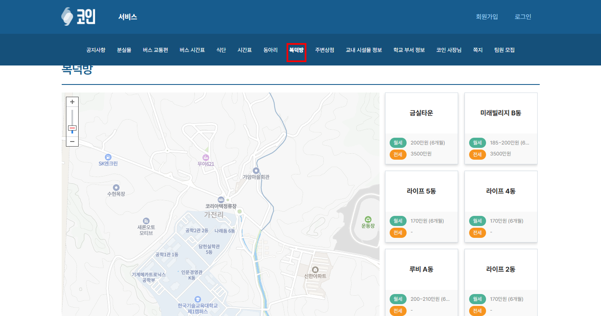

# 1-1 헤더_복덕방 진입(클릭)

원문 페이지 ID: d830221954bc83b0b15701ad86117c71

> 원문 스냅샷. 명세 확정·앱 배포·수집 완료를 뜻하지 않습니다.

## 원문 속성

```json
{
  "platform": [
    "WEB"
  ],
  "url": "source-page-id:d830221954bc83b0b15701ad86117c71",
  "상태": "완료",
  "생성일": "2026-11-08T10:51:52.132Z",
  "이벤트 이름": "1-1 헤더\\_복덕방 진입(클릭)"
}
```

<details>
<summary>이전 로깅</summary>

<span color="orange">event\_params.key</span>

<ul>
<li>
event\_label : header
</li>
<li>
value : 복덕방 
</li>
<li>
event\_category : click <br />
</li>
</ul>
</details>

<details>
<summary>새 로깅 (26.10.17)</summary>

- 설명: 웹 상단 헤더의 서비스 메뉴에서 복덕방을 클릭해 복덕방 목록 화면으로 들어가는 경우
- screen\_view: <code>header</code>
- event\_name: <code>DA1</code>
- event\_label: <code>real_estate__header__real_estate_entry__header_entry__click</code>
- value: 복덕방
- event\_category: <code>click</code>

<details>
<summary>검토사항</summary>

- screen\_view 확정 (2026-10-30 상민 직접 지시): event\_label의 두 번째 구간과 같은 <code>header</code> 고정값을 사용한다. 이전 동적 화면명 표기안은 이 결정으로 대체한다. 라벨·category·value·발생 시점·플랫폼·사진은 유지하며 SDK 적용·실제 전송·한 번 전송은 미확인이다.
- 통합 가이드: [로깅 통합 가이드](3c30221954bc8214b1c481c5bbb6fba5.md)
- 모바일: 없음
- label DA2 기준 정렬 (2026-10-27): <code>real_estate__header__entry__click</code> → <code>real_estate__header__real_estate_entry__header_entry__click</code>
</details>

### 참고사진 (생활편의 → 복덕방 · WEB 리디자인)

<b>웹</b>

<details>
<summary>참고사진 · 웹</summary>

생활편의 → 복덕방. 출처: [Figma WEB 리디자인](https://www.figma.com/design/DPlcYuiFxhyT5ULbqec59i/KOIN-Web?node-id=11541-33352), 2026-11-04 원본 캡처에 코드로 빨간 네모만 추가. 빨간 네모는 기존 명세가 지칭하는 클릭 대상이다. 실제 클릭 가능 여부·SDK 적용·배포·수집은 미확인이다.


</details>

<b>기존 참고사진 (과거 디자인·원문 보존)</b>

### 참고사진 (헤더 복덕방)

<columns>
<column ratio="50">
<b>웹</b>

<details>
<summary>참고사진 · 웹</summary>

웹 — 헤더 복덕방 (출처: stage 실제 캡처, 빨간 네모 = 클릭 위치)


</details>
</column>
<column ratio="50">
<b>모바일</b>

<details>
<summary>참고사진 · 모바일</summary>

모바일 — 해당 없음 (웹 전용)
</details>
</column>
</columns>
</details>
