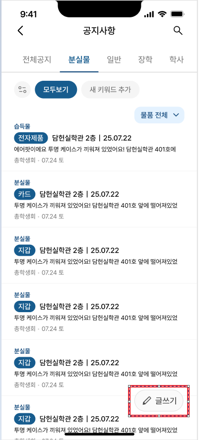
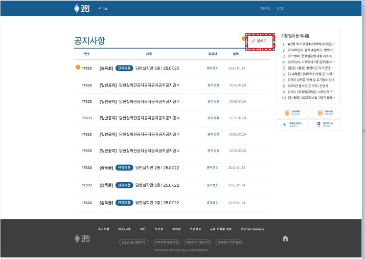
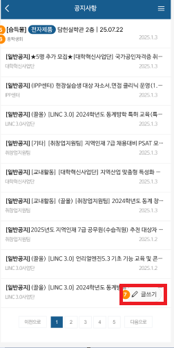

# 11-1.분실물_글쓰기_클릭

원문 페이지 ID: d860221954bc839197140166ccb6103b

> 누락 원본 복구 스냅샷. 원본의 과거값·검토 기록을 보존하며 생성 계약으로 자동 승인하지 않습니다.

대조 기록: [87개 원본 복구 및 8개 차이 정리](../recovery-review.md)

관련 기존 보관본: [11-1.분실물_글쓰기_클릭](57d0221954bc83f4b9d601b04f6c3eab.md), [11-1.분실물_글쓰기_클릭](cd10221954bc822899d7010ce7df27d1.md)

## 원문 속성

```json
{
  "platform": [
    "ANDROID",
    "IOS",
    "WEB"
  ],
  "url": "source-page-id:d860221954bc839197140166ccb6103b",
  "상태": "완료",
  "이름": "11-1.분실물\\_글쓰기\\_클릭"
}
```

- 설명: 분실물 페이지 에서 글쓰기 버튼 클릭(모바일)
- 웹: 공지사항 페이지에서 글쓰기 버튼 클릭
- event\_label : “item\_write”
- value : “글쓰기”
- event\_category : “click”
- 참고사진








WEB Mobile View



