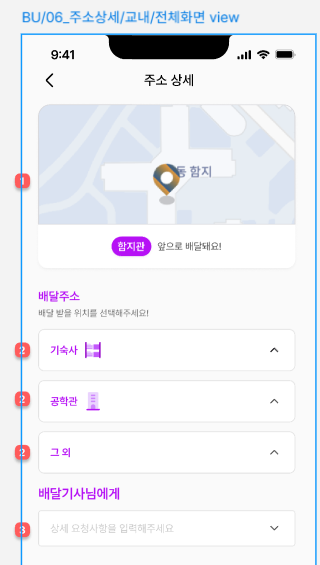

# 7-3 결제 → 교내 주문 페이지 이탈

원문 페이지 ID: d8c0221954bc83b490be8155c4d73bdb

> 원문 스냅샷. 명세 확정·앱 배포·수집 완료를 뜻하지 않습니다.

## 원문 속성

```json
{
  "platform": [
    "WEB"
  ],
  "url": "source-page-id:d8c0221954bc83b490be8155c4d73bdb",
  "상태": "로깅 필요",
  "생성일": "2026-11-08T10:51:55.260Z",
  "이벤트 이름": "7-3 결제 → 교내 주문 페이지 이탈"
}
```




좌측 상단의 교내 주문 페이지 이탈 로깅입니다.


<span color="orange">event\_params.key</span>

<ul>
<li>
event\_label : payment\_campus\_back
</li>
<li>
value : 
</li>
<li>
event\_category : 

<ul>
<li>
click 
</li>
<li>
swipe
</li>
</ul>
</li>
<li>
previous\_page : 교내
</li>
<li>
current\_page : 결제
</li>
<li>
duration\_time : 교내 페이지에서 머무르는 시간  
</li>
</ul>
