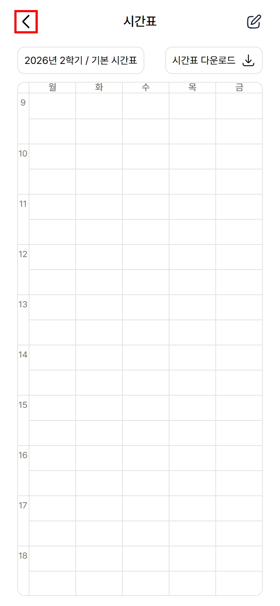

# 2-10. 시간표 탈출_뒤로가기버튼

원문 페이지 ID: daa0221954bc83fd9ea98165d8b666db

> 사용자 제공 ZIP 내보내기 보관본. 레거시·동결·검토 상태는 원문을 따르며 코드 생성 승인·앱 배포 완료를 뜻하지 않습니다.

생성일: 2026년 11월 12일 오후 2:08
태그: 시간표
platform: ANDROID, IOS
상태: 완료

- 과거 로깅
    - event_label : “timetable_back”
    - value : “뒤로가기버튼”
    - event_category : “click”
- 새 로깅
    - 설명: 모바일 시간표 화면 왼쪽 위 뒤로가기(<) 버튼을 눌러 시간표에서 나가는 경우
    - screen_view: `timetable`
    - event_name: `DA1`
    - event_label: `timetable__timetable__navigation__back__click`
    - value: 뒤로가기
    - event_category: `click`
    
    ### 참고사진 (기능 표시)
    
    **웹**
    
    **참고사진 · 웹**
    
    해당 없음 (모바일 전용)
    
    **모바일**
    
    **참고사진 · 모바일**
    
    모바일 — 뒤로가기 버튼 (출처: stage 실제 캡처, 빨간 네모 = 클릭 위치)
    
    
