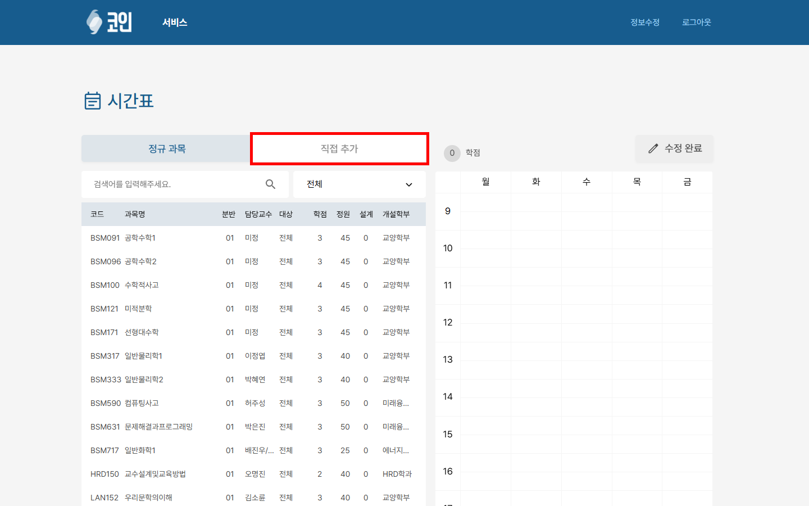

# 2-30. (웹) 시간표 수정_탭 (클릭) - 추가된 로깅

원문 페이지 ID: db80221954bc82b48c1c813c9d4dac9c

> 원문 스냅샷. 명세 확정·앱 배포·수집 완료를 뜻하지 않습니다.

## 원문 속성

```json
{
  "platform": [
    "WEB"
  ],
  "url": "source-page-id:db80221954bc82b48c1c813c9d4dac9c",
  "상태": "로깅 필요",
  "생성일": "2026-11-12T05:08:11.112Z",
  "이벤트 이름": "2-30. (웹) 시간표 수정\\_탭 (클릭) - 추가된 로깅",
  "태그": [
    "시간표"
  ]
}
```

<details>
<summary>과거 로깅</summary>

- 없음 (새로 추가한 로깅)
</details>

<details>
<summary>새 로깅</summary>

- 설명: 웹 시간표 수정 화면에서 정규 과목 / 직접 추가 탭 중 하나를 클릭해 강의 목록과 직접 일정 입력을 오가는 경우
- screen\_view: <code>timetable_edit</code>
- event\_name: <code>DA1</code>
- event\_label: <code>timetable__timetable_edit__timetable_edit__tab__click</code>
- value: \{정규 과목 / 직접 추가\} (예: 직접 추가)
- event\_category: <code>click</code>

### 참고사진 (기능 표시)

<columns>
<column ratio="50">
<b>웹</b>

<b>참고사진 · 웹</b>

웹 — 시간표 수정 탭 (출처: stage 실제 캡처, 로그인 상태, 빨간 네모 = 클릭 위치 / 직접 추가 탭)


</column>
<column ratio="50">
<b>모바일</b>

<b>참고사진 · 모바일</b>

해당 없음 (웹 전용)
</column>
</columns>
</details>
