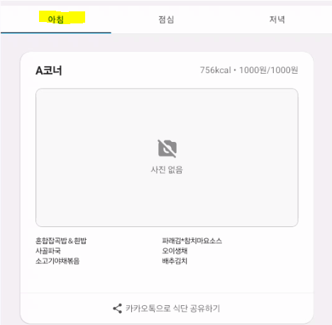
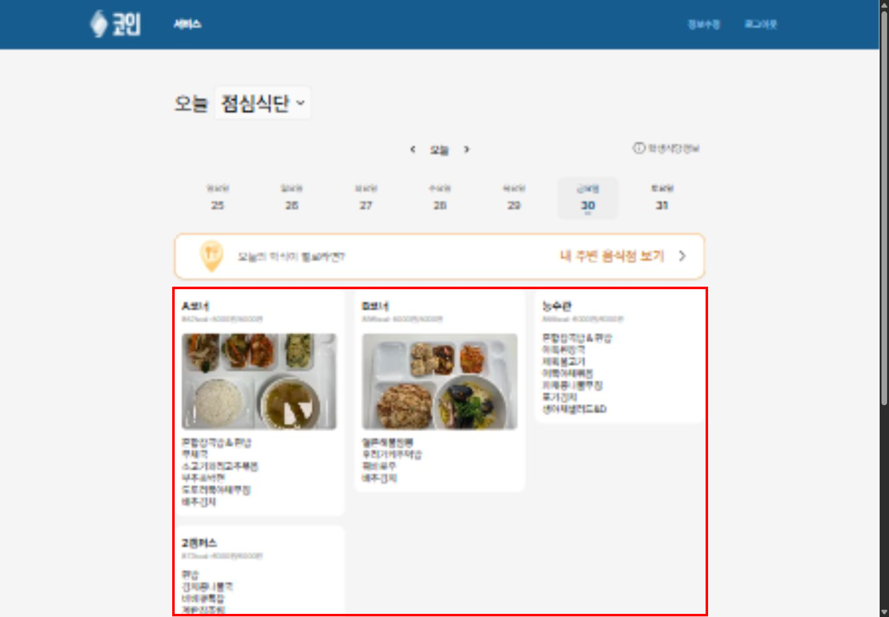
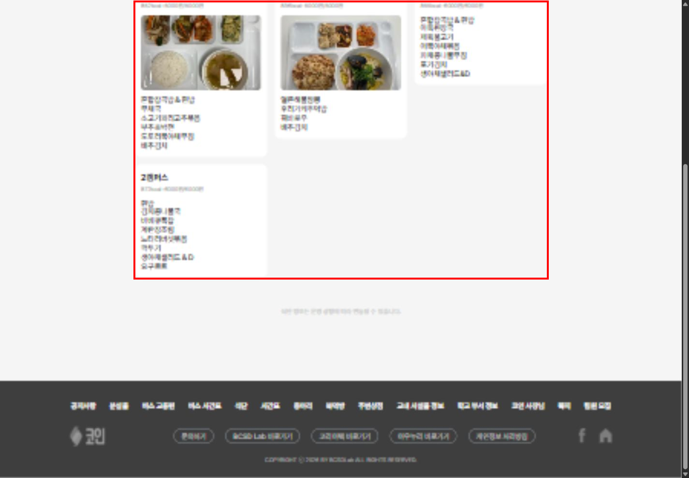
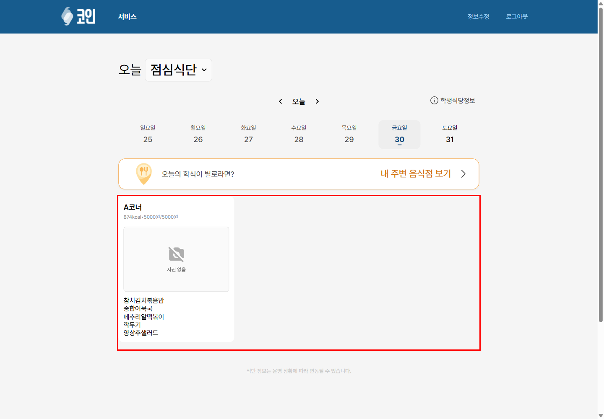
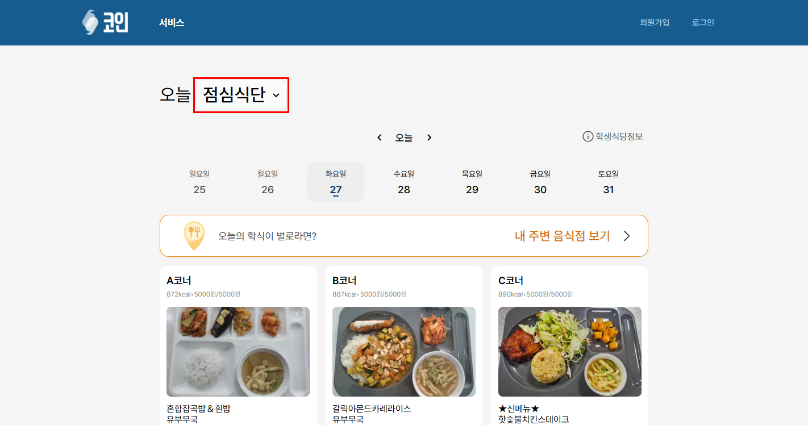
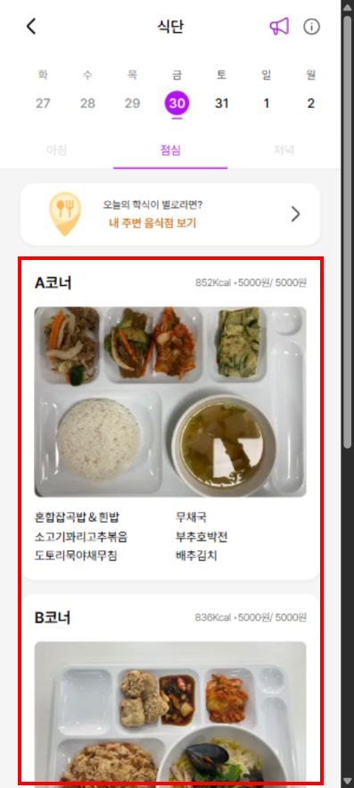
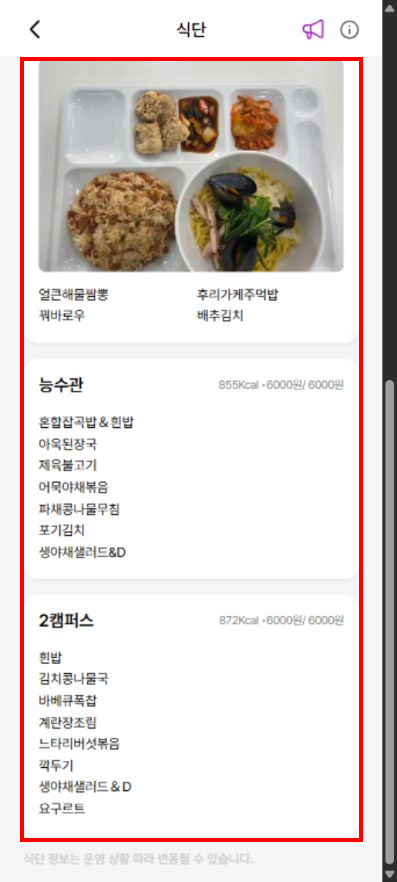
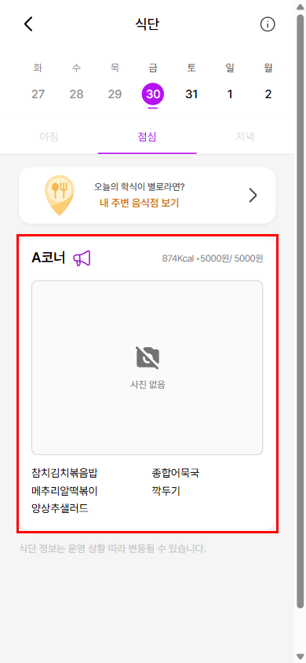
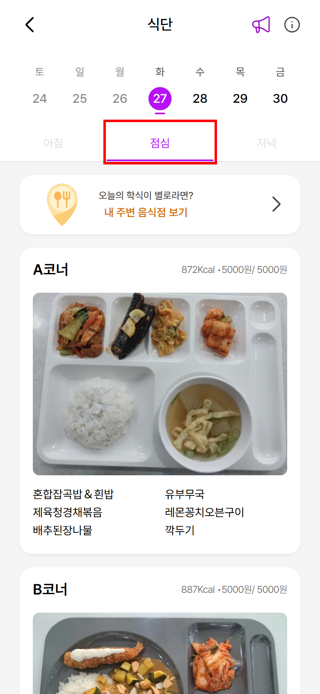

# 3-4. 식단_아침_스크롤

원문 페이지 ID: dc00221954bc83f5923e01ff8270898e

> 누락 원본 복구 스냅샷. 원본의 과거값·검토 기록을 보존하며 생성 계약으로 자동 승인하지 않습니다.

대조 기록: [87개 원본 복구 및 8개 차이 정리](../recovery-review.md)

관련 기존 보관본: [3-4. 식단_아침_스크롤](51f0221954bc821cb2648147bef8d890.md), [3-1. 식단_식사시간 선택 (클릭) - 3-2·3-3 통합](1830221954bc82da965501008d23f1f3.md), [3-9 상점상세 이벤트 (스크롤) ](3740221954bc8299aee60160f0b07426.md), [3-4, 4.5 상점상세 메뉴 (클릭,스크롤) ](58e0221954bc82829b4e8199df6dde60.md)

## 원문 속성

```json
{
  "platform": [
    "ANDROID",
    "IOS",
    "WEB"
  ],
  "url": "source-page-id:dc00221954bc83f5923e01ff8270898e",
  "상태": "완료",
  "생성일": "2026-11-08T10:51:37.138Z",
  "이름": "3-4. 식단\\_아침\\_스크롤",
  "태그": [
    "3. 식단 상세페이지"
  ]
}
```

<details>
<summary>이전 로깅</summary>


- 설명 : 식단 페이지에서 아침 식사 부분에서 스크롤
- event\_label : “menu\_time”
- value : “아침<b>”</b>
- event\_category : “scroll”
- 참고사진





- 웹

</details>


<details>
<summary>새 로깅 (26.10.17)</summary>


- 설명: 식단 화면에서 선택된 식사 시간(아침 / 점심 / 저녁)의 식단 목록을 스크롤하는 경우 (기존 3-4·3-5·3-6을 하나로 통합)
- screen\_view: <code>cafeteria</code>
- event\_name: <code>DA1</code>
- event\_label: <code>cafeteria__cafeteria__meal_time__scroll</code>
- value: \{식사 시간\} (예: 점심)
- event\_category: <code>scroll</code>

<details>
<summary>검토사항</summary>


- 통합 가이드·후속: [로깅 통합 가이드](3c30221954bc8214b1c481c5bbb6fba5.md)
- 참고사진 재검수 (2026-10-30): 식사시간 탭 대신 실제 식단 목록을 표시한 WEB·모바일 웹 캡처로 교체했다. 이전 사진은 교체 전 이력에 보존했다. 스크롤 SDK 수집 여부는 별도 확인 대상이다.
- 기존 식사시간 선택 요소 사진은 교체 전 이력에 보존한다. 새 사진은 실제 식단 목록의 위치 참고자료이며, 목록 내부 스크롤 또는 페이지 스크롤의 SDK 대상·방향은 구현 확인이 필요하다. 라벨·category·value·발생 조건은 유지한다.

</details>


### 참고사진 (식단 스크롤)


<b>웹</b>

<details>
<summary>스크롤 전후 · 운영 WEB (2026-10-30)</summary>


출처: [koreatech.in](http://koreatech.in) 실제 점심 식단 목록 화면. 빨간 테두리=목록 영역. 실제 스크롤 후 화면 위치를 비교하는 참고자료이며 SDK 이벤트 대상·발화·중복 전송은 미확인이다.





WEB · 스크롤 전 · 2026-10-30.





WEB · 스크롤 후 · 2026-10-30.


</details>


<details>
<summary>참고사진 · 웹</summary>





WEB · stage 실제 식단 목록. 빨간 테두리=선택한 식사시간의 식단 목록 영역. 식사시간 탭과 구분. 2026-10-30.


</details>


<details>
<summary>교체 전 참고사진 · 웹 (이력)</summary>


보조자료: 기존 stage 실제 캡처의 식사시간 선택 요소 위치. 빨간 네모는 식단 목록의 스크롤 영역을 표시한 것이 아니다. 이 명세의 대표 스크롤 대상 사진은 동작 범위 확인 후 추가 필요.





</details>


<b>모바일</b>

<details>
<summary>스크롤 전후 · 운영 모바일 웹 (2026-10-30)</summary>


출처: [koreatech.in](http://koreatech.in) 실제 점심 식단 목록 화면. 빨간 테두리=목록 영역. 실제 스크롤 후 화면 위치를 비교하는 참고자료이며 SDK 이벤트 대상·발화·중복 전송은 미확인이다. 네이티브 Android/iOS 앱 캡처와 구분한다.





모바일 웹 · 스크롤 전 · 2026-10-30.





모바일 웹 · 스크롤 후 · 2026-10-30.


</details>


<details>
<summary>참고사진 · 모바일</summary>





모바일 웹 · stage 실제 식단 목록. 보라색 식사시간 UI 아래 목록을 표시. Android/iOS 앱과 구분. 2026-10-30.


</details>


<details>
<summary>교체 전 참고사진 · 모바일 (이력)</summary>


보조자료: 기존 stage 실제 캡처의 식사시간 탭 위치. 이 사진만으로 식단 목록 스크롤이나 탭 스와이프를 확정하지 않는다. 실제 스크롤 대상·방향 확인 후 대표사진 추가 필요.





</details>


</details>
