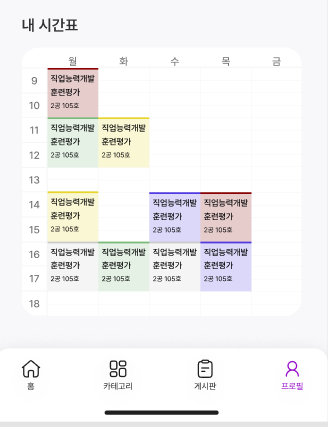
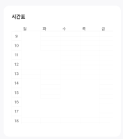

# 4-1 내 시간표 클릭

원문 페이지 ID: dc20221954bc82d391d881b774708e1f

> 원문 스냅샷. 명세 확정·앱 배포·수집 완료를 뜻하지 않습니다.

## 원문 속성

```json
{
  "platform": [
    "ANDROID",
    "IOS",
    "WEB"
  ],
  "url": "source-page-id:dc20221954bc82d391d881b774708e1f",
  "구분": "프로필",
  "상태": "완료",
  "생성일": "2026-11-08T10:52:03.111Z",
  "이벤트 이름": "4-1 내 시간표 클릭"
}
```

- event\_label : home\_timetable
- value : 내 시간표
- event\_category : click




<details>
<summary>새 로깅 (26.11.01)</summary>

<b>내 시간표</b>

- 설명: 프로필 화면의 내 시간표 버튼을 클릭할 때 기록한다. 카테고리·헤더·푸터 시간표 진입과 구분한다.
- screen\_view: <code>main_profile</code>
- event\_name: <code>DA2</code>
- event\_label: <code>timetable__main_profile__timetable_entry__entry__click</code>
- value: 내 시간표
- event\_category: <code>click</code>

<details>
<summary>검토사항</summary>

- WEB 리디자인 반영 (2026-11-04 사용자 승인): WEB 리디자인 홈에는 시간표 위젯이 있으나 이 항목의 ‘프로필 화면 내 시간표’ 버튼은 확인되지 않는다. 해당 WEB 홈에는 main\_profile 명세를 적용하지 않는다. ANDROID·IOS 명세는 유지하고, 시간표 위젯 클릭 가능 여부·이동 목적지가 확인되기 전 임의로 main 라벨을 만들지 않는다.
- WEB 설계 근거: [Figma 참고 / 실제 화면 미확인](https://www.figma.com/design/DPlcYuiFxhyT5ULbqec59i/KOIN-Web?node-id=11541-33352). 기존 사진은 교체하지 않았으며 리디자인 화면의 위치 근거로 사용하지 않는다. SDK 구현·배포 시점·실제 수집은 미확인이다. 이 WEB 규정은 해당 화면의 과거 WEB 설명보다 우선하며 모바일·이전 로깅·기존 필드 값·DB 플랫폼 속성은 보존한다.
- 사용자 승인 (2026-11-01): 기존 동작을 공통 네이밍 형식으로 정리하고 새 명세의 event\_name을 DA2로 통일했다. 기존 CAMPUS 지시와 과거 label·value·category·사진은 위 원문에 보존한다. 새 사용자 동작이나 추가 전송을 만드는 작업이 아니다.
- 이전 → 새 label: <code>home_timetable</code> → <code>timetable__main_profile__timetable_entry__entry__click</code>.
- 기존 click category·고정 value·선택값 의미·클릭 시점을 유지한다. 기존 DB 플랫폼 속성을 보존했으며, 실제 지원 플랫폼·SDK 적용·배포·한 번 전송은 미확인이다.
- 참고사진은 위 기존 사진을 그대로 참조한다. 이 작업에서 촬영·교체·플랫폼 재분류하지 않았다.
- 기준: [로깅 통합 가이드](3c30221954bc8214b1c481c5bbb6fba5.md), [event_label 기능·행동 네이밍 사전](38b0221954bc831b912c012d8af2c857.md), [화면 정의 및 로깅 검수](0e40221954bc823d92c301f83b5f68d0.md).
</details>

### 참고사진 (WEB 시간표 위젯 · 대응 미확정)

<b>웹</b>

<details>
<summary>참고사진 · 웹</summary>

사용자 제공 WEB 리디자인 시간표 위젯. 기존 APP 프로필 ‘내 시간표’ 명세와 다른 위치이다. 클릭 가능 여부·목적지·이벤트 계약은 미확인이므로 기존 main\_profile 라벨을 이 이미지에 적용하지 않는다.


</details>

모바일

<details>
<summary>참고사진 · 모바일</summary>


</details>
</details>
