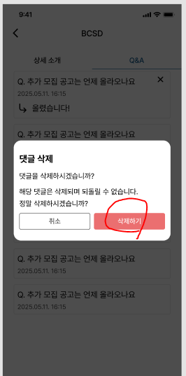
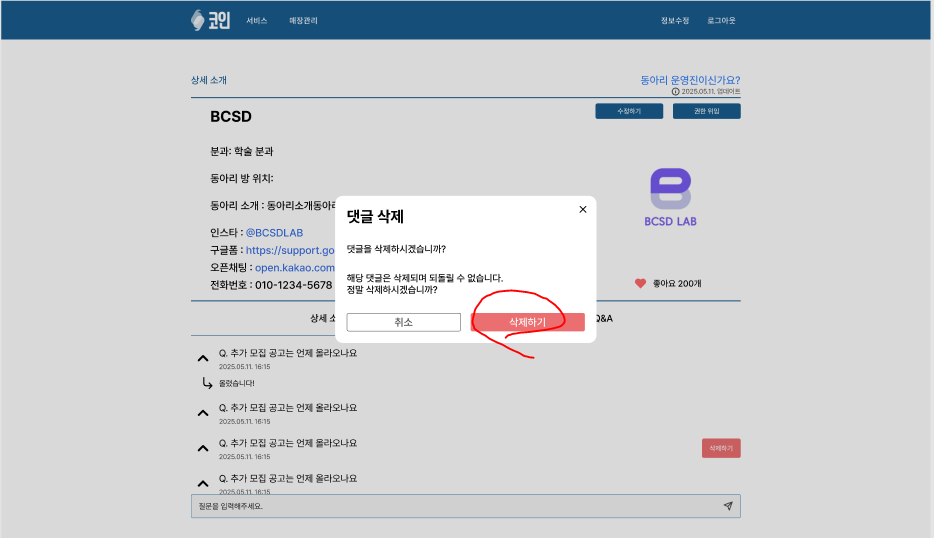
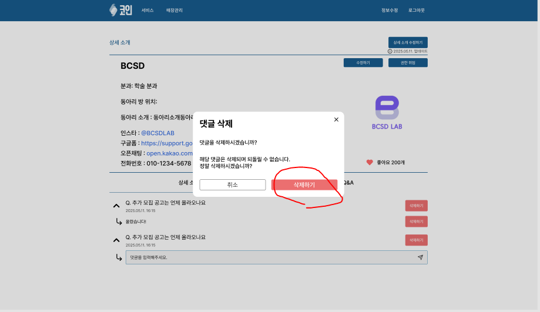

# 4-3. 동아리_댓글 삭제

원문 페이지 ID: dcc0221954bc828b8856013ad4c40742

> 필터 밖 원본 행 복구 스냅샷. 중복·빈 페이지도 원본 ID와 속성, 본문을 개별 보존합니다. 명세 승인이나 앱 적용 완료를 뜻하지 않습니다.

대조 기록: [숨겨진 원본 42개 복구](../hidden-recovery.md)

관련 기존 보관본: [레거시 4-3. 동아리_댓글 삭제](bb50221954bc82c78e0d01fe1913325f.md), [레거시 4-3. 동아리_댓글 삭제](d3d0221954bc83fd8a46811dcfe03cf3.md)

## 원문 속성

```json
{
  "platform": [
    "ANDROID",
    "IOS",
    "WEB"
  ],
  "url": "source-page-id:dcc0221954bc828b8856013ad4c40742",
  "상태": "완료",
  "이름": "4-3. 동아리\\_댓글 삭제"
}
```

<ul>
<li>
설명: 댓글 삭제 팝업에서 삭제하기 클릭
</li>
<li>
event\_name : “CAMPUS”
</li>
<li>
event\_label : “club\_Q&A\_delete\_confirm”
</li>
<li>
value : “삭제하기”
</li>
<li>
event\_category : “click” 
</li>
<li>
참고사진
</li>
</ul>





- 웹 참고사진





- 웹 참고사진2(관리자 버전)



