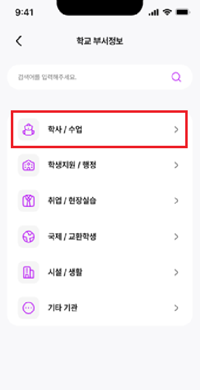
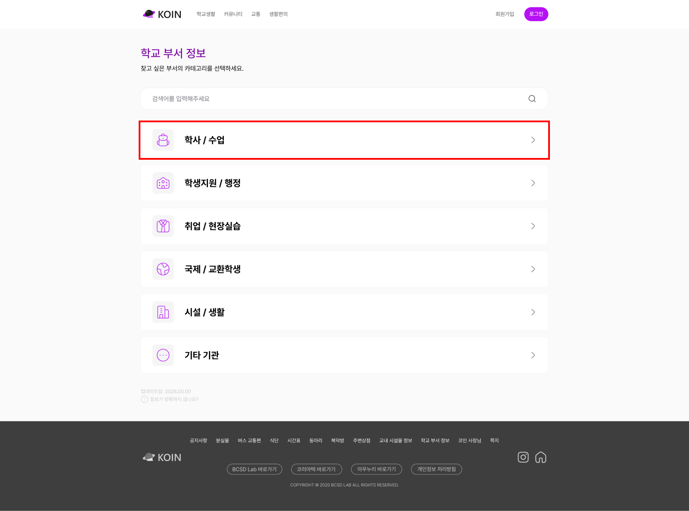
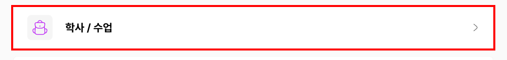
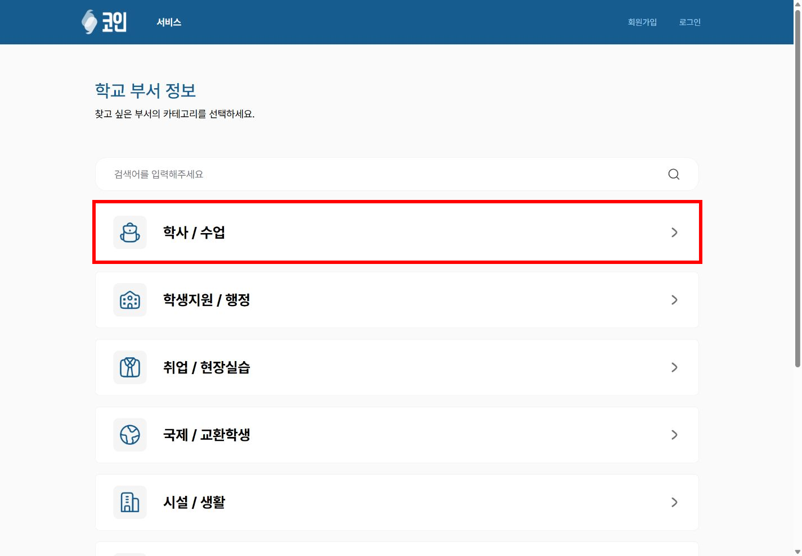
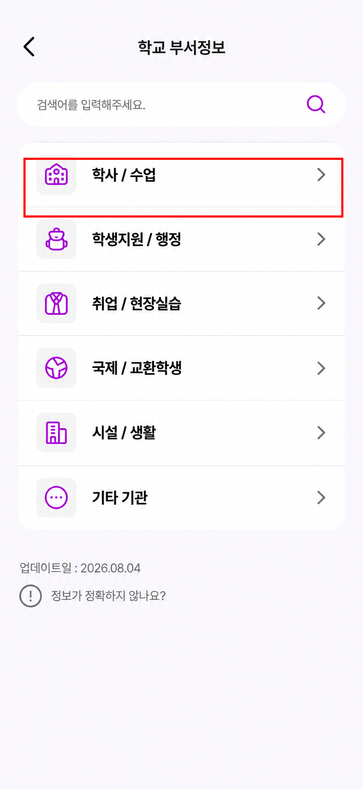

# 1-1 카테고리 클릭 

원문 페이지 ID: dd90221954bc8353a98b810d3b4ffc2e

> 원문 스냅샷. 명세 확정·앱 배포·수집 완료를 뜻하지 않습니다.

## 원문 속성

```json
{
  "platform": [
    "ANDROID",
    "IOS",
    "WEB"
  ],
  "url": "source-page-id:dd90221954bc8353a98b810d3b4ffc2e",
  "구분": "학교 부서정보",
  "상태": "완료",
  "생성일": "2026-11-08T10:52:08.404Z",
  "이벤트 이름": "<p>\n1-1 카테고리 클릭 \n</p>"
}
```

<details>
<summary>이전 로깅</summary>

<p>
팀 : CAMPUS 
</p>

나머지 로깅들도 전부 CAMPUS로 해주세요\~\~


- event\_label : department\_category
- value : \{학사 / 수업\} or \{학생지원 / 행정\} or \{취업 / 현장실습\} 등등
- event\_category : click



</details>

<details>
<summary>새 로깅 (2026-10-14) — 초안</summary>

- 설명: 부서 분류 선택 화면에서 학사/수업 등 분류 항목을 클릭한다.
- screen\_view: <code>department_main</code>
- event\_label: <code>department__department_main__department_category__click</code>
- event\_name: <code>DA2</code>
- value: \{학사 / 수업\} or \{학생지원 / 행정\} or \{취업 / 현장실습\} 등등
- event\_category: <code>click</code>

<details>
<summary>검토사항</summary>

- WEB 참고사진 반영 (2026-11-04 사용자 요청 정정): 아래 새 WEB 캡처와 빨간 네모·확대본을 기준으로 클릭 위치를 확인한다. 리디자인 전 WEB 사진은 이력으로 보존하며 모바일 사진·명세와 이전 로깅은 유지한다.
- WEB 리디자인 반영 (2026-11-04 사용자 승인): WEB: ‘학교 부서 정보\_부서 선택’의 학사/수업 등 분류 행을 클릭해 해당 부서 목록으로 들어가는 동작이다. 헤더 서비스 진입과 구분하고 department\_main 및 기존 새 라벨을 유지한다. 모바일 정의는 그대로 유지한다.
- WEB 설계 근거: [Figma 참고 / 실제 화면 미확인](https://www.figma.com/design/DPlcYuiFxhyT5ULbqec59i/KOIN-Web?node-id=17699-29849). 기존 사진은 교체하지 않았으며 리디자인 화면의 위치 근거로 사용하지 않는다. SDK 구현·배포 시점·실제 수집은 미확인이다. 이 WEB 규정은 해당 화면의 과거 WEB 설명보다 우선하며 모바일·이전 로깅·기존 필드 값·DB 플랫폼 속성은 보존한다.
- 방식 A 반영 (2026-10-28 사용자 확인): 승인된 기존 event\_category <code>click</code>을 복원하고 label 마지막 구간을 일치시켰다. <code>department__department_main__department_category__select</code> → <code>department__department_main__department_category__click</code>. label 끝에 맞춰 category를 바꾼 과거 후속 메모는 이 결정으로 대체한다. 기존 value·event\_name·플랫폼·전송 시점은 유지하며 성공/실패 이벤트를 새로 만들지 않는다.
- 통합 가이드·후속: [로깅 통합 가이드](3c30221954bc8214b1c481c5bbb6fba5.md)
- label 통일 (2026-10-27): 변경 없음(이미 규칙 충족) <code>department__department_main__department_category__select</code>. 참고: event\_category는 click이라 label 끝 select와 불일치, 확인 필요. → 2026-10-27 해소
- 승인 category 복원 확인 (2026-10-28): 이전 사용자 방식 A 승인에 따라 기존 click을 유지한다. label 끝 단어만 click에 맞추며, category를 select/submit/toggle로 변경하라는 과거 후속 메모는 철회한다.
- 구분: 이 항목은 department\_main 내부 분류 선택이다. 1-0-2·홈 리디자인 3-6의 서비스 진입과 별개이며 통합하지 않는다. 웹·모바일에 모두 존재하므로 WEB을 유지한다.
</details>

### 참고사진 (기능 표시)

<b>웹(데스크톱)</b>

<details>
<summary>참고사진 · 웹</summary>

WEB 리디자인 · [Figma 시안](https://www.figma.com/design/DPlcYuiFxhyT5ULbqec59i/KOIN-Web?node-id=17699-29689) · 2026-11-04. 빨간 네모는 이 명세의 클릭 위치다. 원본 캡처에 코드로 테두리만 표시했으며 실제 서비스 캡처·배포 완료를 의미하지 않는다.

<b>전체 화면</b>



<b>클릭 위치 확대</b>



<details>
<summary>이전 WEB 참고사진 (리디자인 전)</summary>

화면 정의의 실제 데스크톱 웹 캡처(2026-10-13). 이번 작업은 기존 캡처를 사용.


</details>
</details>

<b>모바일 (ANDROID, IOS) / 캡처 출처는 아래 참조</b>

<details>
<summary>참고사진 · 모바일</summary>

화면 정의의 Android 실제 캡처(2026-10-13), 선명도 개선본. 이번 작업은 기존 캡처를 사용.


</details>
</details>
