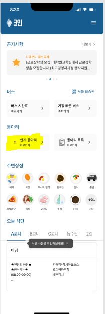
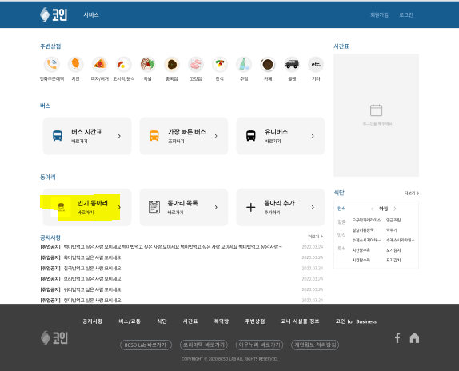

# [레거시] 1-2.동아리_인기동아리 바로가기

원문 페이지 ID: ddd0221954bc83fa889f8133d6e708be

> 원문 스냅샷. 명세 확정·앱 배포·수집 완료를 뜻하지 않습니다.

## 원문 속성

```json
{
  "platform": [
    "ANDROID",
    "IOS",
    "WEB"
  ],
  "url": "source-page-id:ddd0221954bc83fa889f8133d6e708be",
  "상태": "레거시",
  "이름": "\\[레거시\\] 1-2.동아리\\_인기동아리 바로가기",
  "태그": [
    "1. 코인 메인화면_동아리"
  ]
}
```

<callout icon="🗃️" color="gray_bg">
<b>레거시 — 동아리 로깅 전체 현행 적용 제외</b>

- 2026-11-04 사용자 지시로 동아리 로깅 전체를 레거시로 보존한다. 이 페이지는 신규 구현·추가 전송·새 네이밍 적용의 기준이 아니다.
- 기존 event\_name·event\_label·value·category·사진·플랫폼과 원문을 그대로 보존한다. 새 라벨을 만들거나 DA1/DA2로 재배정하지 않는다.
- 서비스 전체 기준: [동아리 (레거시)](95f0221954bc835bb9aa8168f3972017.md). 실제 SDK 수집 종료 여부는 별도 확인 대상이다.
</callout>

- 설명:  코인 메인화면에서 인기동아리 동아리 바로가기
- 모바일기준 B안화면에서만 해당되는 로깅
- event\_name : “CAMPUS”
- event\_category : “click”
- event\_label : “main\_popular\_club”
- value : “인기 동아리”


- 모바일



- 웹




