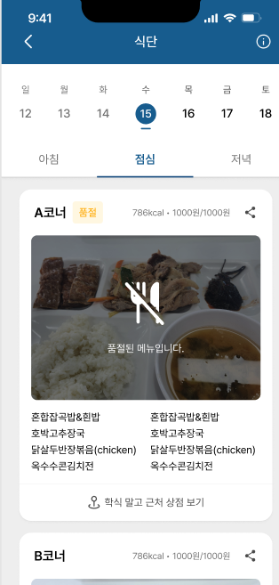
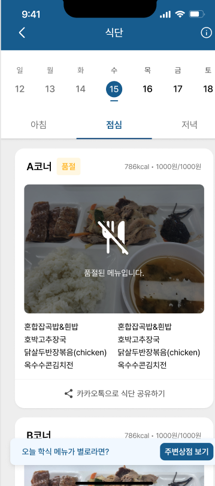

# 0-2. 식단_ABtest_진입

원문 페이지 ID: de00221954bc82a3a8a901bae84118ed

> 원문 스냅샷. 명세 확정·앱 배포·수집 완료를 뜻하지 않습니다.

## 원문 속성

```json
{
  "platform": [
    "ANDROID",
    "IOS",
    "WEB"
  ],
  "url": "source-page-id:de00221954bc82a3a8a901bae84118ed",
  "상태": "완료",
  "생성일": "2026-11-08T10:51:37.347Z",
  "이름": "0-2. 식단\\_ABtest\\_진입",
  "태그": [
    "0. A/B TEST"
  ]
}
```

<details>
<summary>이전 로깅</summary>

- 설명: 사용자가 앱을 키는 순간 생성되는 이벤트입니다.
- event\_name : “AB\_TEST”
- event\_category : “a/b test 로깅(메인화면 식단 진입)”
- event\_label : “dining2shop\_1”
- value : design\_A / design\_B
- custom\_session\_id : \{dining2shop\}\_\{0\}\_\{플랫폼\}\_\{세션시작시간\}\_\{랜덤값\}


<p>
커스텀 세션 아이디 - 원문 (원문 ID: 2759ae650b5980f1bc4fee4a1a377139) 
</p>


- A안(control group)



- B안(variant group)


</details>

<details>
<summary>새 로깅 (26.10.17)</summary>

- 설명: 식단 A/B 테스트(상점가기 배너) 그룹이 정해져 노출될 때 자동으로 찍히는 이벤트 (사용자 클릭 아님). 실험이 끝나면 삭제
- screen\_view: <code>cafeteria</code>
- event\_name: <code>DA1</code>
- event\_label: <code>cafeteria__cafeteria__ab_test__exposure</code>
- value: \{실험 그룹\} → design\_A / design\_B (예: design\_A) — 실험 식별용이라 영문 그대로 둔다
- event\_category: <code>exposure</code>

<details>
<summary>검토사항</summary>

- 통합 가이드·후속: [로깅 통합 가이드](3c30221954bc8214b1c481c5bbb6fba5.md)
- 참고: custom\_session\_id는 과거 정의 그대로 유지
- 참고사진: 자동 노출 이벤트(클릭 위치 없음)라 stage 이미지 없음
</details>

### 참고사진 (A/B 테스트 노출)

<columns>
<column ratio="50">
<b>웹</b>

<details>
<summary>참고사진 · 웹</summary>

해당 없음 (자동 노출 이벤트)
</details>
</column>
<column ratio="50">
<b>모바일</b>

<details>
<summary>참고사진 · 모바일</summary>

해당 없음 (자동 노출 이벤트)
</details>
</column>
</columns>
</details>
