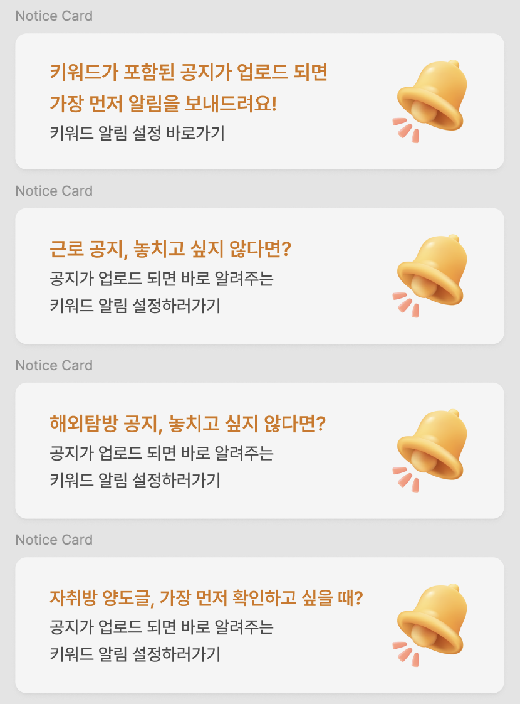

# 8-3. 키워드 관리 진입 배너_클릭

원문 페이지 ID: de10221954bc8300b30d8107e140ad3e

> 누락 원본 복구 스냅샷. 원본의 과거값·검토 기록을 보존하며 생성 계약으로 자동 승인하지 않습니다.

대조 기록: [87개 원본 복구 및 8개 차이 정리](../recovery-review.md)

관련 기존 보관본: [8-3. 키워드 관리 진입 배너_클릭](fa20221954bc8295ab7101d34c0e80c9.md), [8-3. 키워드 관리 진입 배너_클릭](4bf0221954bc83c78b7081fd636e4039.md)

## 원문 속성

```json
{
  "platform": [
    "ANDROID",
    "IOS"
  ],
  "url": "source-page-id:de10221954bc8300b30d8107e140ad3e",
  "상태": "완료",
  "이름": "8-3. 키워드 관리 진입 배너\\_클릭"
}
```

<ul>
<li>
설명 : 메인 배너에서 키워드 알림설정 바로가기 (A/B테스트용)

- 첫 배너에서 사용자당 업데이트 후 7일마다 변경됨
</li>
<li>
event\_label : “to\_manage\_keyword”
</li>
<li>
value : “안내글”<b>, “근로”, “해외탐방”, “자취방 양도”</b>
</li>
<li>
event\_category : “click” 
</li>
<li>
참고사진





</li>
</ul>
