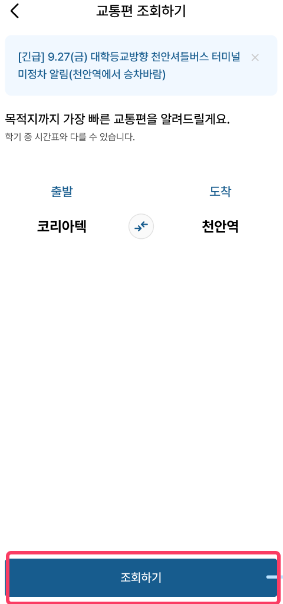
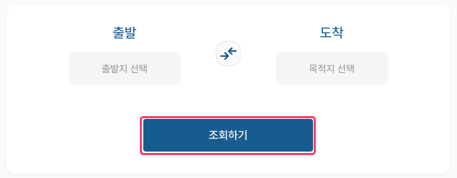
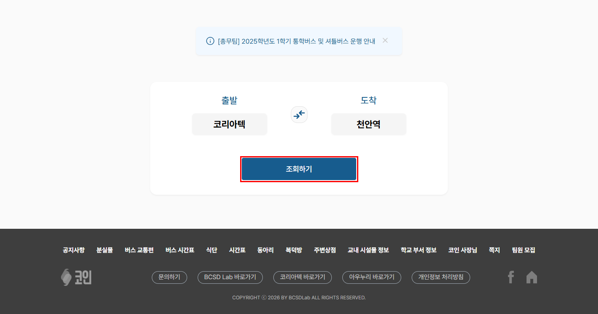

# 5-6. 조회하기_클릭

원문 페이지 ID: de60221954bc82adb7ed01df276aea7c

> 원문 스냅샷. 명세 확정·앱 배포·수집 완료를 뜻하지 않습니다.

## 원문 속성

```json
{
  "platform": [
    "ANDROID",
    "IOS",
    "WEB"
  ],
  "url": "source-page-id:de60221954bc82adb7ed01df276aea7c",
  "상태": "완료",
  "생성일": "2026-11-12T05:07:51.922Z",
  "이벤트 이름": "5-6. 조회하기\\_클릭",
  "태그": [
    "5. 교통편 조회하기"
  ]
}
```

<details>
<summary>과거 로깅</summary>

- event\_label : “search\_bus”
- value : “조회하기<b>”</b>
- event\_category : “click”
- 참고사진





AND, IOS, WEB(Mobile View)





WEB

</details>

<details>
<summary>새 로깅</summary>

- 설명: 버스 교통편 화면에서 조회하기를 클릭해 조회 결과 화면으로 들어가는 경우
- screen\_view: <code>bus_search</code>
- event\_name: <code>DA1</code>
- event\_label: <code>bus__bus_search__search__click</code>
- value: 조회하기
- event\_category: <code>click</code>

### 참고사진 (기능 표시)

<columns>
<column ratio="50">
<b>웹</b>

<b>참고사진 · 웹</b>

웹 — 조회하기 클릭 (출처: stage 실제 캡처, 빨간 네모 = 클릭 위치)


</column>
<column ratio="50">
<b>모바일</b>

<b>참고사진 · 모바일</b>

기존 모바일 참고사진 사본 — 이전 로깅에서 ANDROID·IOS·WEB(Mobile View)로 명시된 이미지. 빨간 네모 = 조회하기 버튼. 현행 stage 반응형 웹은 출발·도착 선택 후 즉시 결과를 표시하므로 이 사진을 현행 웹 캡처나 현행 앱 구현 검증으로 사용하지 않는다.

파란색 구버전 모바일 사진 제거 (2026-10-30).
</column>
</columns>
</details>
