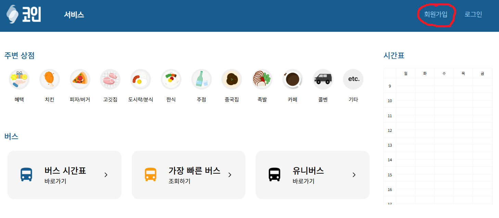
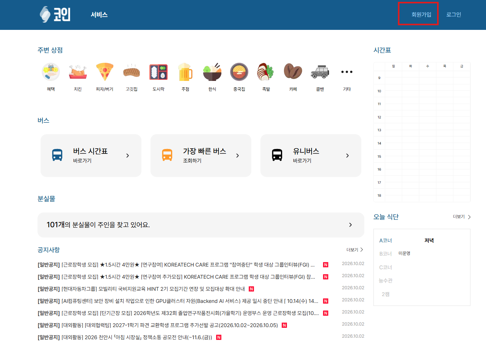

# 1-1 헤더_회원가입진입(클릭)

원문 페이지 ID: dee0221954bc830599bc81e876d5a738

> 원문 스냅샷. 명세 확정·앱 배포·수집 완료를 뜻하지 않습니다.

## 원문 속성

```json
{
  "platform": [
    "WEB"
  ],
  "url": "source-page-id:dee0221954bc830599bc81e876d5a738",
  "구분": "회원가입진입",
  "상태": "로깅 필요",
  "생성일": "2026-11-08T10:51:23.619Z",
  "이벤트 이름": "1-1 헤더\\_회원가입진입(클릭)",
  "태그": [
    "회원가입"
  ]
}
```

<details>
<summary>이전 로깅</summary>

- screen\_view: ‘main’
- event\_label : “main\_\_main\_\_sign\_up\_\_entry”
- value : “회원가입 시작<b>”</b>
- event\_category : “click”
- custom\_session\_id : \{sign\_up\}\_\{0\}\_\{플랫폼\}\_\{세션시작시간\}\_\{랜덤값\}



</details>

<details>
<summary>새 로깅 (26.10.04)</summary>

- 설명: 웹 헤더의 회원가입 버튼을 클릭해 회원가입 화면으로 진입할 때 기록한다.
- event\_name: <code>DA2</code>
- screen\_view: <code>header</code>
- event\_label: <code>account__header__sign_up__header_entry__click</code>
- value: 회원가입 시작
- event\_category: <code>click</code>
- custom\_session\_id : \{sign\_up\}\_\{0\}\_\{플랫폼\}\_\{세션시작시간\}\_\{랜덤값\}

<details>
<summary>검토사항</summary>

- screen\_view 확정 (2026-10-30 상민 직접 지시): event\_label의 두 번째 구간과 같은 <code>header</code> 고정값을 사용한다. 이전 동적 화면명 표기안은 이 결정으로 대체한다. 라벨·category·value·발생 시점·플랫폼·사진은 유지하며 SDK 적용·실제 전송·한 번 전송은 미확인이다.
- label 통일 (2026-10-27): <code>account__header__sign_up__header_entry</code> → <code>account__header__sign_up__header_entry__click</code>
</details>

### 참고사진 (헤더 → 회원가입 · WEB 리디자인)

<b>웹</b>

<details>
<summary>참고사진 · 웹</summary>

헤더 → 회원가입. 출처: [Figma WEB 리디자인](https://www.figma.com/design/DPlcYuiFxhyT5ULbqec59i/KOIN-Web?node-id=11541-33352), 2026-11-04 원본 캡처에 코드로 빨간 네모만 추가. 빨간 네모는 기존 명세가 지칭하는 클릭 대상이다. 실제 클릭 가능 여부·SDK 적용·배포·수집은 미확인이다.


</details>

<b>기존 참고사진 (과거 디자인·원문 보존)</b>

<details>
<summary>참고사진</summary>


</details>
</details>


