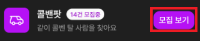
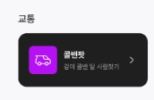
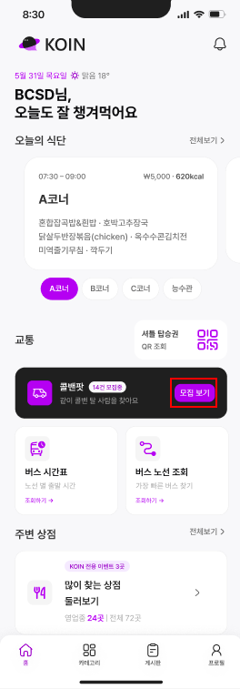

# 1-6 콜벤팟 모집 보기 클릭

원문 페이지 ID: df60221954bc833f92f28142f80b2646

> 원문 스냅샷. 명세 확정·앱 배포·수집 완료를 뜻하지 않습니다.

## 원문 속성

```json
{
  "platform": [
    "ANDROID",
    "IOS"
  ],
  "url": "source-page-id:df60221954bc833f92f28142f80b2646",
  "구분": "홈화면",
  "상태": "완료",
  "생성일": "2026-11-08T10:52:05.612Z",
  "이벤트 이름": "1-6 콜벤팟 모집 보기 클릭"
}
```

<callout icon="📌" color="blue_bg">
<b>현행 홈 대표 명세 · 이 페이지의 로깅 유지</b>

2026-11-05 사용자 지시로 메인 콜밴팟 모집보기는 이 홈 명세를 기준으로 적용한다. [[레거시] 1-1 메인 → 콜밴팟 모집 보기](1130221954bc82689c42016c8a03d063.md)는 레거시 이력이며 별도 신규 구현·추가 전송 대상이 아니다. 아래 이전의 외부 대표 지정·두 문서 공동 계약·별개 유지 설명은 이 결정으로 대체한다. 기존 홈 라벨·value·category·event\_name·screen\_view·플랫폼·사진·발생 조건은 유지한다. SDK 단일 전송은 별도 확인한다.
</callout>

<details>
<summary>이전 로깅</summary>

- event\_label : callvanpot
- value : 콜밴팟 모집보기
- event\_category : click





</details>

<details>
<summary>새 로깅 (2026-10-14) — 초안</summary>

- 설명: 메인 교통 영역에서 콜밴팟 모집 보기를 클릭한다.
- screen\_view: <code>main</code>
- event\_label: <code>callvan__main__callvan_entry__recruitment_list_entry__click</code>
- event\_name: <code>DA2</code>
- value: 콜밴팟 모집보기
- event\_category: <code>click</code>

<details>
<summary>검토사항</summary>

- 동일 이벤트 문서 계약 (2026-11-01): 사용자 승인으로 새 value를 “콜밴팟 모집보기”로 통일한다. 기준 명세는 [[레거시] 1-1 메인 → 콜밴팟 모집 보기](1130221954bc82689c42016c8a03d063.md), 대응 명세는 [1-6 콜벤팟 모집 보기 클릭](df60221954bc833f92f28142f80b2646.md)다. 메인 교통 영역의 모집 보기 클릭 한 번에 문서 수만큼 추가·중복 전송하지 않는다. 기존 label·screen\_view·event\_name·category·플랫폼과 이전 로깅은 유지한다. 실제 호출 지점·플랫폼별 SDK 전송값·한 번 전송은 미확인이다.
- 통합 가이드·후속: [로깅 통합 가이드](3c30221954bc8214b1c481c5bbb6fba5.md)
- 2026-10-15 대응 확정: [[레거시] 1-1 메인 → 콜밴팟 모집 보기](1130221954bc82689c42016c8a03d063.md)을 이 리디자인 메인 모집 보기 기능으로 교체. 이 1-6 항목은 별도 홈화면 리디자인 문서에 있다. WEB은 적용 대상에서 제외하며 동일 클릭을 이중 전송하지 않는다.
- label 통일 (2026-10-27): callvan\_\_main\_\_callvan\_entry\_\_recruitment\_list\_entry → callvan\_\_main\_\_callvan\_entry\_\_recruitment\_list\_entry\_\_click
</details>

### 참고사진 (기능 표시)

<details>
<summary>웹</summary>


</details>

<b>모바일 (ANDROID, IOS) / 캡처 출처는 아래 참조</b>

<details>
<summary>참고사진 · 모바일</summary>

화면 정의에 제공된 메인 캡처. 실제 Android 캡처 출처 미확인; 버튼 위치 참고.


</details>
</details>
